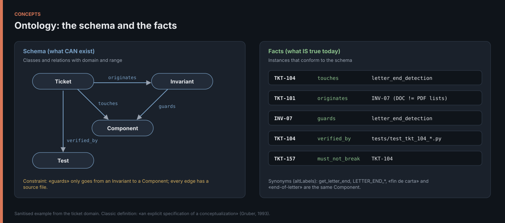
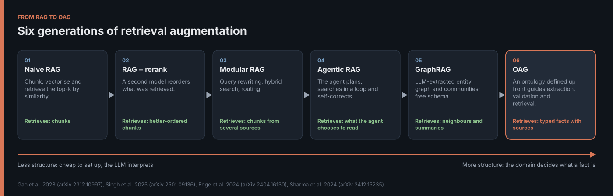
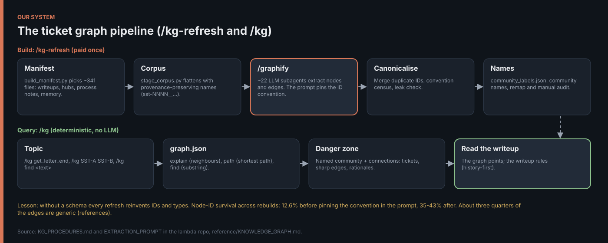
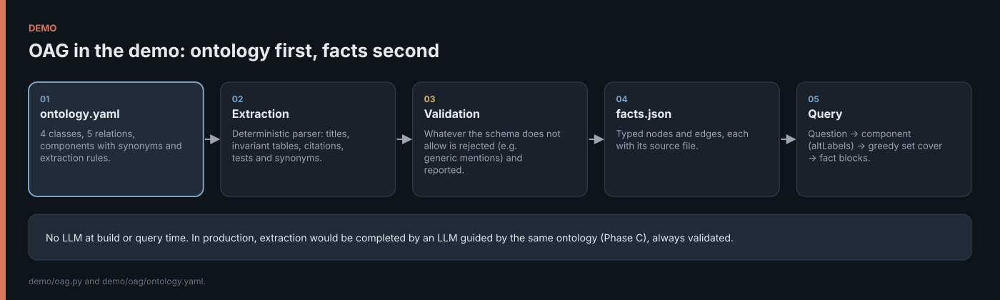
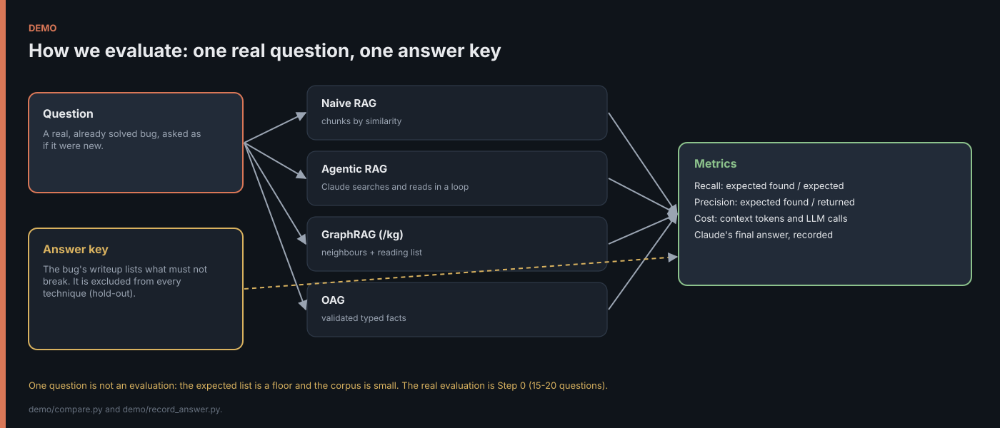
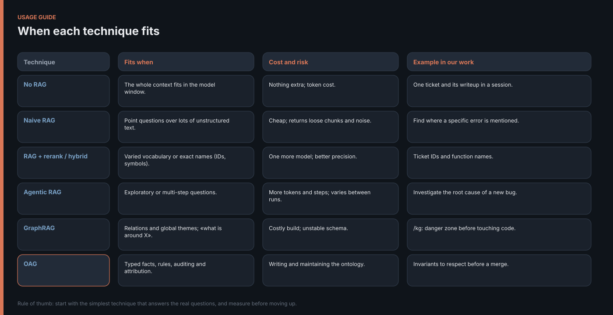

# Presentation and demo guide: from Naive RAG to OAG

> Versión en castellano: [GUIA_DEMO.md](GUIA_DEMO.md). Deck: `presentacion/OAG_vs_KG_Presentation_EN.pptx`
> (EN) and `presentacion/OAG_vs_KG_Presentacion.pptx` (ES). Diagrams: `docs/img/` (regenerate with
> `python docs/img/build_diagrams.py --png`).

This guide is for presenting Ontology-Augmented Generation (OAG) and running the live demo with Claude
Code. It follows the order of the session: concepts first, then our system, the demo, the evaluation
and, finally, when each technique fits.

## Running order

| Block | Content | Approximate time |
|---|---|---|
| 1 | What OAG is and why now | 5 min |
| 2 | Concepts: ontology, facts, schema-first | 10 min |
| 3 | From RAG to OAG and the OG-RAG pipeline | 10 min |
| 4 | Our ticket graph: what it does and what we learned | 10 min |
| 5 | Live demo: five skills | 20 min |
| 6 | Evaluation, results and when to use each technique | 10 min |

---

## 1. What OAG is

A language model answers better when it is given the right context. Retrieval-Augmented Generation (RAG)
looks for that context in documents and adds it to the prompt (Lewis et al., 2020). The basic form
retrieves text chunks similar to the question. It works, but the model receives loose fragments and has
to guess what is a fact, how facts relate and where each one comes from.

**Ontology-Augmented Generation** changes the unit of retrieval: instead of text chunks, the system
retrieves **typed facts** that conform to a domain schema written in advance, the ontology. Retrieval
and generation happen inside that schema: the domain decides what a fact is, which relations exist and
which rules must hold.

The term is used in three different senses, and it helps to keep them apart:

| Source | What it means by OAG |
|---|---|
| Sharma, Kumar and Li, OG-RAG (Microsoft Research, EMNLP 2025) | A concrete, evaluated method: documents mapped to the ontology as *fact blocks*, a hypergraph and set-cover retrieval |
| Palantir Foundry | A platform practice: documents are objects of a business Ontology with objects, links and actions |
| L. Huang, *From RAG to OAG* (Medium) | A conceptual frame: the ontology as a normative layer (classes, relations, OWL/SHACL-style axioms) |

## 2. Key concepts



- **Ontology.** An explicit, shared specification of a domain (Gruber, 1993): what kinds of things exist,
  how they relate and which rules they must satisfy, written so a machine can use and validate it. It is
  not a taxonomy or a list of tags.
- **Class.** A kind of thing in the domain: `Ticket`, `Invariant`, `Component`, `Test`.
- **Relation.** A named, directed link with a domain and a range: `Invariant guards Component`.
- **Attribute.** A property of a class: title, status, source file.
- **Constraint.** What can be true: `guards` only starts at an `Invariant`; every edge has a source. On
  the semantic web these are expressed in OWL and validated with SHACL (W3C).
- **Instance or fact.** A concrete statement that conforms to the schema:
  `TKT-104 touches letter_end_detection`.
- **Synonyms (altLabels).** The words free text uses for the same concept. They are what lets
  `get_letter_end`, `LETTER_END_*` and "end of letter" be treated as one thing.
- **Fact block.** A group of facts about one entity, serialised as JSON-LD in OG-RAG. It is the unit
  that gets retrieved.
- **Hypergraph.** A graph in which an edge (hyperedge) joins more than two nodes. In OG-RAG each fact
  block is a hyperedge and each key-value pair a node.
- **Set cover.** Choosing the smallest number of fact blocks that cover every node relevant to the
  question. OG-RAG solves it greedily.
- **Schema-first versus schema-emergent.** In OAG the schema exists before extraction and extraction
  sticks to it. In GraphRAG, and in our current graph, the LLM decides the types while extracting.
- **Attribution.** Every fact points to its source document, so the answer can be checked.

## 3. From RAG to OAG



| Generation | Idea | Reference |
|---|---|---|
| Naive RAG | Chunk, vectorise, top-k by similarity | Lewis et al., 2020; Gao et al., 2023 |
| RAG + rerank | A second model reorders what was retrieved | Gao et al., 2023 |
| Modular RAG | Query rewriting, hybrid search, routing | Gao et al., 2023 |
| Agentic RAG | The agent plans, retrieves in a loop and self-corrects | Singh et al., 2025 |
| GraphRAG | LLM-extracted entity graph and community summaries | Edge et al., 2024 |
| OAG | An up-front ontology guides extraction, validation and retrieval | Sharma et al., 2024 |

### The OG-RAG pipeline


1. **Ontology**: triples (subject, attribute, value) written or reviewed by experts.
2. **Preprocessing**: an LLM maps each document to the ontology and emits JSON-LD fact blocks.
3. **Hypergraph**: fact blocks as hyperedges, key-value pairs as nodes.
4. **Retrieval**: top-k nodes by key and by value similarity; then the smallest set of hyperedges that
   covers them.
5. **Generation**: the facts go into the prompt. No extra LLM calls at query time.

Published results (Table 1 of the paper, context recall):

| Dataset | RAG | RAPTOR | GraphRAG | OG-RAG |
|---|---|---|---|---|
| Soybean | 0.22 | 0.54 | 0.41 | **0.84** |
| Wheat | 0.14 | 0.85 | 0.78 | **0.95** |
| News | 0.01 | 0.82 | did not finish in a day | 0.82 |

Small print: proprietary data, two domains, hand-written ontologies, and answer relevance does not
always improve (RAPTOR wins on wheat and news). The gain is in fact recall; the price is building and
maintaining the ontology.

## 4. Our system: the ticket graph



The graph indexes the project memory (per-ticket writeups, `SHARP_EDGES`, `STATUS`, `FOLLOWUPS`,
extractor process notes, memory notes) to answer *what broke before and what surrounds* the thing we
are about to change. It complements CodeGraph, which answers *what the code is and what calls what*.

- **Build (`/kg-refresh`)**: a manifest picks about 341 files; they are flattened into a corpus; about 22
  LLM subagents (graphify) extract nodes and edges; IDs are canonicalised; communities are named. It is
  expensive, but it is paid once.
- **Query (`/kg`)**: deterministic and LLM-free over `graph.json`: neighbours, path between two tickets
  or text search. It returns the danger zone and a reading list. The graph points; the writeup rules.

### What we learned (and why OAG matters)

The figures come from `KG_PROCEDURES.md` in the lambda repo:

- **IDs do not survive without a schema.** In the 2026-08-10 rebuild only 12.6% of node IDs survived,
  because each extraction chose its own ID scheme. Pinning the convention in the extraction prompt raised
  survival to 35-43%. That is a first step towards schema-first.
- **Graph size swings between rebuilds**: from 2,163 to 3,921 nodes on a similar corpus, depending on how
  extraction was chunked.
- **Naming communities costs about an hour per refresh**, and only 31% to 46% of the names carry over.
  They have to be audited by hand.
- **Edges are mostly generic**: about three quarters are `references`. The graph says what to read, not
  which fact each file contributes.
- **Typed relations already exist** where the source is structured: the ticket status tables contribute
  `implemented_by`, `is_blocked_by`, `has_parent`. That part already behaves like an ontology.

Conclusion: our graph does roughly half of OAG (knowledge as a graph, expensive inference paid once,
attribution, used before acting). It lacks the up-front schema, validation and returning facts.

## 5. The demo

Five Claude Code skills answer the same real question over the same corpus. Technical detail in
`demo/README.md`.

### Setup (before the session)

```bash
git pull
pip install -r demo/requirements.txt
python demo/oag.py build
python demo/compare.py        # quick check that everything answers
```

The data lives in `data/` (outside git): the kg corpus, `graph.json` and `questions.yaml`.

### The question

> I have to fix a new bug: in a DOCX side letter the end-of-letter marker is "run-in" (inside a
> paragraph, after a clause), `get_letter_end` does not detect it and the signature block ends up inside
> the last provision. Which earlier tickets and invariants must I respect so I do not break anything?

It is a real bug that has already been investigated. Its writeup lists what must not break, written by
the person who solved it. That list is the answer key, and the writeup is excluded from every technique.

### Step by step

| Skill | What to show | What to say |
|---|---|---|
| `/demo-naive-rag` | The 5 retrieved chunks and the tickets that appear | It finds the words, not the facts. It does not know which ticket matters or why |
| `/demo-agentic-rag` | Claude planning, searching and reading, step by step | Better precision for more steps and tokens; every run differs |
| `/demo-graphrag` | The neighbours of `get_letter_end`, their edge types and the reading list | Cheap and deterministic. It says what to read; two hops gain recall and lose precision |
| `/demo-oag` | `ontology.yaml`, the validation report (what was rejected) and the fact blocks | Schema first. Each fact says which invariant it originates, who asks not to break it and which test pins it |
| `/demo-compare` | The final table | Recall, precision and cost, with their limits |



In `/demo-oag` three things are worth showing: the synonyms of the `letter_end_detection` component (why
the question finds the component), the 31 generic mentions rejected by validation (why the resulting
graph is cleaner) and one full fact block (what the model receives).

## 6. How we evaluate



- **Expected answer**: the tickets the bug's writeup says to respect (7 in the current question).
- **Hold-out**: the writeup and its notes are excluded from the corpus, the graph and the facts.
- **Recall** = expected found / expected. **Precision** = expected found / returned.
- **What counts as returned**: for Naive RAG, the tickets appearing in the chunks; for GraphRAG, those in
  the neighbours and the reading list; for OAG, the subject of each fact block and the origins of its
  invariants (not tickets that only appear as provenance).
- **Cost**: context tokens and LLM calls during retrieval.
- **Claude's answer**: each skill records the final answer; that is the comparison that matters live.

Results with 14 corpus files (before copying the full corpus):

| Technique | Recall | Precision | Context tokens | LLM calls during retrieval |
|---|---|---|---|---|
| Naive RAG | 100% | 39% | ~1,700 | 0 |
| GraphRAG (/kg, 1 hop) | 43% | 43% | ~370 | 0 |
| GraphRAG (/kg, 2 hops) | 86% | 23% | larger | 0 |
| OAG | 86% | 60% | ~1,400 | 0 |
| Agentic RAG | live | live | variable | several steps |

How to read them:

- Naive RAG gets everything because the invariant index in `SHARP_EDGES`, already written by hand, is
  retrieved: it is an implicit ontology. With the full corpus there is more competition for the top-k.
- OAG misses one of the seven tickets because its invariant protects title detection, not the end of
  the letter. It is an honest schema gap, fixed with one more relation or component, not with more text.
- One question is not an evaluation. The expected list is a floor: some OAG "false positives" (other
  end-of-letter invariants) are defensible. The real evaluation is Step 0 in `HANDOVER.md`: 15 to 20
  questions with known answers.

## 7. When each technique fits



| Technique | Fits when | Cost and risk |
|---|---|---|
| No RAG | The whole context fits in the window | Tokens only |
| Naive RAG | Point questions over lots of unstructured text | Cheap; loose chunks and noise |
| RAG + rerank / hybrid | Varied vocabulary or exact names (IDs, symbols) | One more model |
| Agentic RAG | Exploratory or multi-step questions | More tokens and steps; variability |
| GraphRAG | Relations and global themes; "what is around X" | Costly build; unstable schema |
| OAG | Typed facts, rules, auditing, attribution | Writing and maintaining the ontology |

Rule of thumb: start with the simplest technique that answers the real questions and measure before
moving up. A large ontology "for completeness" is the main risk of OAG.

## 8. Lessons for the methodology skills

What the demo suggests for `/kg`, `/kg-refresh` and the templates:

1. **Measure before changing**: turn the demo question into the first of a set of 15-20 with known
   answers (Step 0) and measure the current graph.
2. **Write the minimal ontology** from the templates (Phase A): the demo's (`demo/oag/ontology.yaml`) is
   a starting point.
3. **Deterministic backbone** (Phase B): frontmatter in the ticket and sharp-edge templates, plus parsing
   of tables and IDs. The demo extracts all of its facts this way, without an LLM.
4. **Guided, validated extraction** (Phase C): pass the ontology to the graphify subagents and reject in
   `finalize` anything that does not conform. It is the natural next step after pinning the ID
   convention.
5. **`/kg facts <topic>`** (Phase D): return fact blocks with their source, alongside the reading list.

## References

- P. Lewis et al., *Retrieval-Augmented Generation for Knowledge-Intensive NLP Tasks*, NeurIPS 2020.
  [arXiv 2005.11401](https://arxiv.org/abs/2005.11401)
- Y. Gao et al., *Retrieval-Augmented Generation for Large Language Models: A Survey*, 2023.
  [arXiv 2312.10997](https://arxiv.org/abs/2312.10997)
- A. Singh et al., *Agentic Retrieval-Augmented Generation: A Survey on Agentic RAG*, 2025.
  [arXiv 2501.09136](https://arxiv.org/abs/2501.09136)
- D. Edge et al., *From Local to Global: A GraphRAG Approach to Query-Focused Summarization*, 2024.
  [arXiv 2404.16130](https://arxiv.org/abs/2404.16130)
- P. Sarthi et al., *RAPTOR: Recursive Abstractive Processing for Tree-Organized Retrieval*, ICLR 2024.
  [arXiv 2401.18059](https://arxiv.org/abs/2401.18059)
- K. Sharma, P. Kumar, Y. Li, *OG-RAG: Ontology-Grounded Retrieval-Augmented Generation for Large
  Language Models*, 2024; EMNLP 2025. [arXiv 2412.15235](https://arxiv.org/abs/2412.15235),
  [ACL Anthology](https://aclanthology.org/2025.emnlp-main.1674/)
- Palantir, *Ontology augmented generation*.
  [Foundry documentation](https://www.palantir.com/docs/foundry/ontology/ontology-augmented-generation)
- L. Huang, *From RAG to OAG*. [Medium](https://medium.com/@linghuang_76674/from-rag-to-oag-68e3ac807c29)
- T. R. Gruber, *A translation approach to portable ontology specifications*, Knowledge Acquisition 5(2),
  1993.
- W3C, *OWL 2 Web Ontology Language Overview*. [w3.org/TR/owl2-overview](https://www.w3.org/TR/owl2-overview/)
- W3C, *Shapes Constraint Language (SHACL)*. [w3.org/TR/shacl](https://www.w3.org/TR/shacl/)
- Project material: `docs/OAG_VS_KG.md`, `HANDOVER.md`, `reference/KNOWLEDGE_GRAPH.md`, `demo/README.md`.
