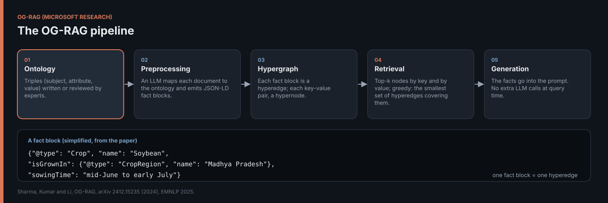
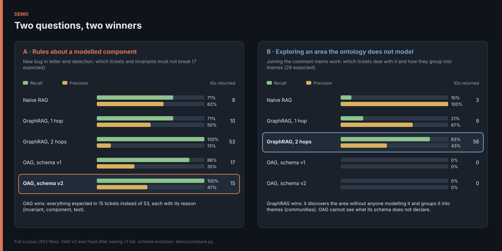

# Presentation and demo guide: from Naive RAG to OAG

> Technical detail (what runs and where): [TECHNICAL_GUIDE.md](TECHNICAL_GUIDE.md).
> Versión en castellano: [GUIA_DEMO.md](GUIA_DEMO.md). Deck: `presentacion/OAG_vs_KG_Presentation_EN.pptx`
> (EN) and `presentacion/OAG_vs_KG_Presentacion.pptx` (ES). Diagrams: `docs/img/` (regenerate with
> `python docs/img/build_diagrams.py --png`).

This guide is for presenting Ontology-Augmented Generation (OAG) and running the live demo with Claude
Code. It follows the order of the session: concepts first, then our system, the demo, the evaluation
and, finally, when each technique fits.

## Running order

| Block | Content | Approximate time |
|---|---|---|
| 1 | What OAG is and why now | 5 min |
| 2 | Concepts: ontology, facts, schema-first | 10 min |
| 3 | From RAG to OAG and the OG-RAG pipeline | 10 min |
| 4 | Our ticket graph: what it does and what we learned | 10 min |
| 5 | Live demo: two questions, five skills | 25 min |
| 6 | Evaluation, results, where each technique wins and whether it is worth it | 15 min |

---

## 1. What OAG is

A language model answers better when it is given the right context. Retrieval-Augmented Generation (RAG)
looks for that context in documents and adds it to the prompt (Lewis et al., 2020). The basic form
retrieves text chunks similar to the question. It works, but the model receives loose fragments and has
to guess what is a fact, how facts relate and where each one comes from.

**Ontology-Augmented Generation** changes the unit of retrieval: instead of text chunks, the system
retrieves **typed facts** that conform to a domain schema written in advance, the ontology. Retrieval
and generation happen inside that schema: the domain decides what a fact is, which relations exist and
which rules must hold.

The term is used in three different senses, and it helps to keep them apart:

| Source | What it means by OAG |
|---|---|
| Sharma, Kumar and Li, OG-RAG (Microsoft Research, EMNLP 2025) | A concrete, evaluated method: documents mapped to the ontology as *fact blocks*, a hypergraph and set-cover retrieval |
| Palantir Foundry | A platform practice: documents are objects of a business Ontology with objects, links and actions |
| L. Huang, *From RAG to OAG* (Medium) | A conceptual frame: the ontology as a normative layer (classes, relations, OWL/SHACL-style axioms) |

## 2. Key concepts


- **Ontology.** An explicit, shared specification of a domain (Gruber, 1993): what kinds of things exist,
  how they relate and which rules they must satisfy, written so a machine can use and validate it. It is
  not a taxonomy or a list of tags.
- **Class.** A kind of thing in the domain: `Ticket`, `Invariant`, `Component`, `Test`.
- **Relation.** A named, directed link with a domain and a range: `Invariant guards Component`.
- **Attribute.** A property of a class: title, status, source file.
- **Constraint.** What can be true: `guards` only starts at an `Invariant`; every edge has a source. On
  the semantic web these are expressed in OWL and validated with SHACL (W3C).
- **OWL (Web Ontology Language).** The W3C standard for writing ontologies (OWL 2, 2009). It declares
  classes, properties, hierarchies and axioms ("every invariant has a ticket of origin", "`guards` goes
  from an invariant to a component"). An OWL reasoner can infer new facts from the declared ones. It uses
  the open-world assumption: a missing fact is not taken as false, only as unknown.
- **SHACL (Shapes Constraint Language).** The W3C standard for validating graph data (2017). It defines
  "shapes" the data must satisfy: the type of each node, the allowed relations, required fields,
  cardinalities. It uses the closed-world assumption: a missing required value is an error, and it
  returns a report of what does not conform. In short: OWL says what can exist and what follows; SHACL
  checks that the data complies.
- **OWL and SHACL in the demo.** We use neither standard, only their idea with light tools: the ontology
  is a YAML file (`demo/oag/ontology.yaml`) that plays the role of OWL, and the validation in
  `oag.py build` (about 30 lines of Python that reject relations outside the schema, wrong domains or
  ranges and edges without a source) plays the role of SHACL. That is why the guides speak of
  "SHACL-style" validation. If the domain grew, the YAML could be translated to OWL and SHACL without
  changing the model.
- **Instance or fact.** A concrete statement that conforms to the schema:
  `TKT-104 touches letter_end_detection`.
- **Synonyms (altLabels).** The words free text uses for the same concept. They are what lets
  `get_letter_end`, `LETTER_END_*` and "end of letter" be treated as one thing.
- **Fact block.** A group of facts about one entity, serialised as JSON-LD in OG-RAG. It is the unit
  that gets retrieved.
- **Hypergraph.** A graph in which an edge (hyperedge) joins more than two nodes. In OG-RAG each fact
  block is a hyperedge and each key-value pair a node.
- **Set cover.** Choosing the smallest number of fact blocks that cover every node relevant to the
  question. OG-RAG solves it greedily.
- **Schema-first versus schema-emergent.** In OAG the schema exists before extraction and extraction
  sticks to it. In GraphRAG, and in our current graph, the LLM decides the types while extracting.
- **Attribution.** Every fact points to its source document, so the answer can be checked.

## 3. From RAG to OAG


| Generation | Idea | Reference |
|---|---|---|
| Naive RAG | Chunk, vectorise, top-k by similarity | Lewis et al., 2020; Gao et al., 2023 |
| RAG + rerank | A second model reorders what was retrieved | Gao et al., 2023 |
| Modular RAG | Query rewriting, hybrid search, routing | Gao et al., 2023 |
| Agentic RAG | The agent plans, retrieves in a loop and self-corrects | Singh et al., 2025 |
| GraphRAG | LLM-extracted entity graph and community summaries | Edge et al., 2024 |
| OAG | An up-front ontology guides extraction, validation and retrieval | Sharma et al., 2024 |

### The OG-RAG pipeline



1. **Ontology**: triples (subject, attribute, value) written or reviewed by experts.
2. **Preprocessing**: an LLM maps each document to the ontology and emits JSON-LD fact blocks.
3. **Hypergraph**: fact blocks as hyperedges, key-value pairs as nodes.
4. **Retrieval**: top-k nodes by key and by value similarity; then the smallest set of hyperedges that
   covers them.
5. **Generation**: the facts go into the prompt. No extra LLM calls at query time.

Published results (Table 1 of the paper, context recall):

| Dataset | RAG | RAPTOR | GraphRAG | OG-RAG |
|---|---|---|---|---|
| Soybean | 0.22 | 0.54 | 0.41 | **0.84** |
| Wheat | 0.14 | 0.85 | 0.78 | **0.95** |
| News | 0.01 | 0.82 | did not finish in a day | 0.82 |

Small print: proprietary data, two domains, hand-written ontologies, and answer relevance does not
always improve (RAPTOR wins on wheat and news). The gain is in fact recall; the price is building and
maintaining the ontology.

## 4. Our system: the ticket graph


The graph indexes the project memory (per-ticket writeups, `SHARP_EDGES`, `STATUS`, `FOLLOWUPS`,
extractor process notes, memory notes) to answer *what broke before and what surrounds* the thing we
are about to change. It complements CodeGraph, which answers *what the code is and what calls what*.

- **Build (`/kg-refresh`)**: a manifest picks about 341 files; they are flattened into a corpus; about 22
  LLM subagents (graphify) extract nodes and edges; IDs are canonicalised; communities are named. It is
  expensive, but it is paid once.
- **Query (`/kg`)**: deterministic and LLM-free over `graph.json`: neighbours, path between two tickets
  or text search. It returns the danger zone and a reading list. The graph points; the writeup rules.

### What we learned (and why OAG matters)

The figures come from `KG_PROCEDURES.md` in the lambda repo:

- **IDs do not survive without a schema.** In the 2026-08-10 rebuild only 12.6% of node IDs survived,
  because each extraction chose its own ID scheme. Pinning the convention in the extraction prompt raised
  survival to 35-43%. That is a first step towards schema-first.
- **Graph size swings between rebuilds**: from 2,163 to 3,921 nodes on a similar corpus, depending on how
  extraction was chunked.
- **Naming communities costs about an hour per refresh**, and only 31% to 46% of the names carry over.
  They have to be audited by hand.
- **Edges are mostly generic**: about three quarters are `references`. The graph says what to read, not
  which fact each file contributes.
- **Typed relations already exist** where the source is structured: the ticket status tables contribute
  `implemented_by`, `is_blocked_by`, `has_parent`. That part already behaves like an ontology.

Conclusion: our graph does roughly half of OAG (knowledge as a graph, expensive inference paid once,
attribution, used before acting). It lacks the up-front schema, validation and returning facts.

## 5. The demo

Five Claude Code skills answer the same real questions over the same corpus. The demo does not look for
an overall winner: it has two questions chosen to show where each technique wins and why. Technical
detail in `demo/README.md`.

**How to run it:** the cheat sheet with the terminal commands, how to call each skill inside Claude Code and
what should come out at each step is in [RUN_DEMO.md](RUN_DEMO.md).

### Setup (before the session)

```bash
git pull
uv sync --group embed        # environment with the semantic layer (a plain uv sync removes it)
source .venv/bin/activate    # before starting claude: the skills call `python`
python demo/oag.py build --q letter-end-runin
python demo/oag.py build --q comment-memo-landscape
python demo/compare.py        # quick check and embedding cache
claude                        # from the repo root
```

Inside Claude Code, each skill is invoked with `/` and its name, with the question id and `--lang es` after
it: `/demo-oag comment-memo-landscape`, `/demo-oag letter-end-runin --lang es`. Type `/clear` before each
skill so that no technique uses what the previous one retrieved.

The data lives in `data/` (outside git): the full kg corpus, `graph.json`, the community names and
`questions.yaml`.

### The two questions

**A. Rules about a modelled component** (`letter-end-runin`, OAG expected to win):

> I have to fix a new bug: in a DOCX side letter the end-of-letter marker is "run-in" (inside a
> paragraph, after a clause), `get_letter_end` does not detect it and the signature block ends up inside
> the last provision. Which earlier tickets and invariants must I respect so as not to break anything?

It is a real bug that has already been investigated. Its writeup contains the list of what must not
break, written by whoever solved it. That list is the answer key, and the writeup is excluded from
every technique.

**B. Exploring an area the ontology does not model** (`comment-memo-landscape`, GraphRAG expected to
win):

> I am starting to work on the comment memo extractor and I do not know it. Which earlier tickets deal
> with it and how do they group into themes?

The expected answer comes from an objective rule: every writeup whose title mentions the comment memo
(29). The demo ontology has no such component, on purpose: that is what happens with any area nobody has
modelled yet.

### Step by step

Question A:

| Command in Claude Code | What to show | What to say |
|---|---|---|
| `/demo-naive-rag` | The 5 retrieved chunks and the tickets in them | It finds the words, not the facts. It does not know which ticket matters or why |
| `/demo-agentic-rag` | Claude planning, searching and reading, step by step | More precision at the cost of steps and tokens; every run is different |
| `/demo-graphrag` | The neighbours of `get_letter_end`, their edge types and the reading list | Cheap and deterministic. It says what to read; at two hops it finds everything, but among 53 tickets |
| `/demo-oag` | `ontology.yaml`, what validation rejects and the fact blocks, with v1 and v2 | Schema first. Each fact says which invariant it originates, who asks not to break it and which test pins it |

Question B:

| Command in Claude Code | What to show | What to say |
|---|---|---|
| `/demo-graphrag comment-memo-landscape` | The extractor's neighbours at two hops and the themes (named communities) | Nobody modelled this area and the graph finds it and groups it |
| `/demo-oag comment-memo-landscape` | The query with no components and no facts | OAG only sees what its schema declares. To cover the area it has to be modelled first |
| `/demo-compare` | The English and plain Spanish tables | Where each one wins, with its limits |

Question in plain Spanish (optional, section 6):

| Command in Claude Code | What to show | What to say |
|---|---|---|
| `/demo-oag letter-end-runin --lang es` | No components with v2; with v3 or `--semantic`, the same facts as in English | The language only affects the first step: recognising which component is meant |
| `/demo-graphrag comment-memo-landscape --lang es` | The seed candidates with their similarity | The model finds the area; the central node is still chosen by someone who knows the domain |


In `/demo-oag` four things are worth showing: the synonyms of the `letter_end_detection` component (why
the question finds the component), the generic mentions rejected by validation (why the resulting graph
is cleaner), a full fact block (what the model receives) and the difference between schema v1 and v2
(next subsection).

### From OAG v1 to v2: the schema gets debugged too

The first ontology failed question A in two ways, and both were schema problems, not technique problems:

1. **Noise from an unconstrained relation.** `must_not_break` brought in tickets that a letter-end
   writeup asks not to break but that belong to other areas (numbering, PDF). v2 adds a SHACL-style
   constraint: the protected ticket must share a component with the question. It goes from 17 to 11
   tickets without losing any expected one.
2. **A dependency that was not declared.** Letter-end detection uses `get_titles` to look at the next
   title (an invariant in `SHARP_EDGES` says so), but v1 treated components as islands. v2 adds the
   `calls` relation (letter end calls `get_titles`) and recovers the missing invariant.

`python demo/oag.py query --schema 1` reproduces v1. It has to be told honestly: v2 was written after
seeing what failed. That is the normal way to maintain an ontology, but the result can only be credited
to the technique once it is validated on new questions.

## 6. How we evaluate


- **Expected answer**: in question A, the tickets the bug's writeup says to respect (7); in B, the
  writeups whose title mentions the area (29), an objective rule rather than a hand-picked list.
- **Hold-out**: in question A, the writeup and its notes are excluded from the corpus, the graph and the
  facts. B has no answer key to hide.
- **Recall** = expected found / expected. **Precision** = expected found / returned. **F1** = harmonic
  mean of the two.
- **What counts as returned**: for Naive RAG, the tickets appearing in the chunks; for GraphRAG, those in
  the neighbours and the reading list; for OAG, the subject of each fact block and the origins of its
  invariants (not tickets that only appear as provenance).
- **Cost**: context tokens and LLM calls during retrieval.
- **Claude's answer**: each skill records the final answer; that is the comparison that matters live.

Results with the full corpus (452 files after the hold-out) and the graph rebuilt on 20 November.



**Question A: rules about a modelled component** (7 expected). The last column is the first trial, with
14 files and the previous graph:

| Technique | Recall | Precision | F1 | IDs | Context tokens | With 14 files (R / P) |
|---|---|---|---|---|---|---|
| Naive RAG | 71% | 62% | 0.67 | 8 | ~1,600 | 100% / 39% |
| GraphRAG (/kg, 1 hop) | 71% | 50% | 0.59 | 10 | ~770 | 43% / 43% |
| GraphRAG (/kg, 2 hops) | 100% | 13% | 0.23 | 53 | ~7,000 | 86% / 23% |
| OAG, schema v1 | 86% | 35% | 0.50 | 17 | ~2,000 | 86% / 60% |
| OAG, schema v2 | 100% | 47% | 0.64 | 15 | ~2,500 | - |
| Agentic RAG | live | live | - | variable | variable | - |

**Question B: exploring an area the ontology does not model** (29 expected):

| Technique | Recall | Precision | F1 | IDs | Context tokens |
|---|---|---|---|---|---|
| Naive RAG | 10% | 100% | 0.19 | 3 | ~1,600 |
| GraphRAG (/kg, 1 hop) | 21% | 67% | 0.32 | 9 | ~1,100 |
| GraphRAG (/kg, 2 hops) | 83% | 43% | 0.56 | 56 | ~7,000 |
| OAG, schema v1 and v2 | 0% | - | 0 | 0 | 0 |
| Agentic RAG | live | live | - | variable | variable |

No technique calls an LLM to retrieve, except Agentic RAG, which is Claude itself searching.

How to read them:

- **OAG v2 wins question A, and it is worth saying how.** It is the only technique that finds all seven
  tickets without bringing in 46 others: GraphRAG at two hops also reaches 100%, but among 53. On F1,
  Naive RAG is level because it returns little; but it misses two of the seven, and in a "what must not
  break" question a miss is a regression. Each fact block also says why the ticket matters (invariant,
  component and test), which neither chunks nor a reading list do.
- **GraphRAG wins question B.** It discovers the area without anyone modelling it and groups it into
  themes with the graph's communities (extraction paths, doc mode, status vocabulary, chain boundaries,
  table headers...). OAG returns nothing, because the question names no component of its ontology: it
  does not fail with noise, it fails silently. Naive RAG is right in the little it returns, but a top-5
  cannot answer "everything about X".
- **Naive RAG loses recall as the corpus grows** (100% with 14 files, 71% with 452). With few files the
  `SHARP_EDGES` index was retrieved, and that is already an implicit, hand-written ontology.
- **Two questions are not an evaluation.** The expected list is a floor and OAG v2 was fixed after seeing
  the failure. The real evaluation is Step 0 in `HANDOVER.md`: 15 to 20 questions with known answers,
  mixing both kinds.

### The same question in plain Spanish: the semantic layer

The corpus is in English and the three deterministic techniques compare words: TF-IDF in Naive RAG, node
names in GraphRAG and ontology synonyms in OAG. The questions above work because they carry identifiers
(`get_letter_end`, "comment memo") and because the scripts search with an English version (`query`,
`topic`). To see what happens when someone asks the way they speak, each question has a plain Spanish
version with no code names (`pregunta_llana`) and a Spanish topic for GraphRAG (`tema`). All scripts
accept `--lang es`.

Then a semantic layer is added: a multilingual embedding model (`paraphrase-multilingual-MiniLM-L12-v2`,
about 470 MB, runs on CPU) that puts "fin de carta" close to "letter end". Each technique uses it only at
the step where it compares the question with the corpus:

- **Naive RAG** ranks chunks by similarity of meaning (`--embed`).
- **GraphRAG** picks the seed by similarity to node labels (`--semantic`).
- **OAG** picks components by similarity to their labels (`--semantic`). The model-free alternative is to
  write Spanish synonyms into the ontology (schema v3, `--schema 3`).

**Question A in plain Spanish** (7 expected):

| Technique | Recall | Precision | F1 | IDs |
|---|---|---|---|---|
| Naive RAG, TF-IDF | 14% | 25% | 0.18 | 4 |
| Naive RAG, embeddings | 43% | 38% | 0.40 | 8 |
| GraphRAG (1 hop), seed by name | 0% | - | 0 | 0 |
| GraphRAG (1 hop), seed by similarity | 43% | 75% | 0.55 | 4 |
| OAG v2, English labels | 0% | - | 0 | 0 |
| OAG v3, Spanish labels | 100% | 47% | 0.64 | 15 |
| OAG v2, components by similarity | 100% | 47% | 0.64 | 15 |

**Question B in plain Spanish** (29 expected):

| Technique | Recall | Precision | F1 | IDs |
|---|---|---|---|---|
| Naive RAG, TF-IDF | 0% | 0% | 0 | 3 |
| Naive RAG, embeddings | 10% | 50% | 0.17 | 6 |
| GraphRAG (2 hops), seed by name | 0% | - | 0 | 0 |
| GraphRAG (2 hops), seed by similarity | 59% | 25% | 0.35 | 68 |
| OAG (v2, v3 or by similarity) | 0% | - | 0 | 0 |

How to read them:

- **Without a semantic layer, all three techniques fail.** GraphRAG finds no node called "detección del fin
  de carta" and OAG recognises no component. It is a silent failure: none of them warns that it did not
  understand the question; they just return nothing.
- **On question A, OAG recovers fully with either fix**: six Spanish synonyms in the YAML, or the model
  picking the component. Once the component is identified, the rest of OAG does not depend on the language
  and the facts are the same as in English.
- **GraphRAG with a semantic seed lands in the right area, but not on the best node.** On A it picks
  `letter-end look-ahead` instead of `get_letter_end`; on B, "Comment memo upload and extraction"
  (similarity 0.89) instead of `CommentMemoExtractor`, and it reaches 59% against 83% with the hand-picked
  seed. The model understands the topic; knowing which node is central is still domain knowledge.
- **Embeddings are not better at everything.** In Spanish, Naive RAG clearly improves; in English, on
  question A, embeddings give 57% against 71% for TF-IDF (on B, 28% against 10%). In a technical corpus
  full of identifiers, exact word matching matters.
- **On question B, OAG stays empty with the semantic layer too, and that is right.** The threshold stops
  the comment memo from being mapped to a component it is not (the highest similarity is 0.35). The
  semantic layer does not create knowledge the ontology does not have.
- **OAG's threshold (0.42) is calibrated on these two questions**: it is the midpoint between the correct
  component (0.47) and the best wrong one (0.38) on question A. With so little data it is a custom fit;
  with the Step 0 set it should be fixed on unseen questions. The v3 synonyms do not have that problem,
  but they only cover the words someone has written.

Cost: the model is downloaded once and corpus embeddings are cached (`data/cache/`). The first run takes a
few minutes on CPU; later runs take seconds.

## 7. When each technique fits


| Technique | Fits when | Cost and risk |
|---|---|---|
| No RAG | The whole context fits in the window | Tokens only |
| Naive RAG | Point questions over lots of unstructured text | Cheap; loose chunks and noise |
| RAG + rerank / hybrid | Varied vocabulary or exact names (IDs, symbols) | One more model |
| Agentic RAG | Exploratory or multi-step questions | More tokens and steps; variability |
| GraphRAG | Relations and global themes; "what is around X" | Costly build; unstable schema |
| OAG | Typed facts, rules, auditing, attribution | Writing and maintaining the ontology |

Rule of thumb: start with the simplest technique that answers the real questions and measure before
moving up. A large ontology "for completeness" is the main risk of OAG.

### Where each one wins in our demo

| If the question is... | Use | Because |
|---|---|---|
| "Which rules, tickets or tests protect this component" | OAG | Typed facts with their reason; little noise; validated before reaching the LLM |
| "What is there about this area and how is it organised" | GraphRAG (/kg) | Discovers structure without a prior schema and groups it into themes |
| "Where is this identifier mentioned" | Naive RAG or search | Cheap and immediate; needs no structure |
| "Investigate this new problem" | Agentic RAG | Plans and searches again; costly and variable |
| Any of the above, in Spanish and without code names | The same, with a semantic layer | Synonyms in the ontology or multilingual embeddings in the first step |

OAG does not replace GraphRAG: it complements it. GraphRAG discovers the structure; OAG pins the stable
part as a contract and answers with verifiable facts.

## 8. Lessons for the methodology skills

### Is it worth the effort in our case?

Yes, if it is adopted in parts and only for rules questions. What the demo cost:

- **The ontology**: 4 classes, 6 relations, 1 constraint and 4 components with their English and Spanish
  synonyms, about 70 lines of YAML. Much of it comes from the templates we already use (ISSUE_NOTE, SHARP_EDGES, TEST_MAP).
- **The extraction**: deterministic, no LLM. It parses tables, bullets and IDs; there is no cost per
  query or per rebuild.
- **The maintenance**: every new area we want to query with OAG needs its component and synonyms; every
  failure like v1's is fixed with a rule or a relation. That is the price, and it stays small as long as
  the ontology covers only what we actually ask.

What is not worth it: modelling the whole domain "for completeness" or replacing `/kg`. The graph still
answers exploration questions better.

### What to take to `/kg`, `/kg-refresh` and the templates

1. **Measure before changing**: turn the demo's two questions into the first of a set of 15-20 with
   known answers (Step 0), mixing rules and exploration questions.
2. **Write the minimal ontology** from the templates (Phase A), starting with the components with most
   invariants in `SHARP_EDGES`. The demo's (`demo/oag/ontology.yaml`) is the starting point.
3. **Declare dependencies between components** (`calls`): that is what v1 lacked, and what an emergent
   graph does not give typed.
4. **Deterministic backbone** (Phase B): frontmatter in the ticket and sharp-edge templates, plus parsing
   of tables and IDs. The demo extracts all of its facts this way, without an LLM.
5. **Guided, validated extraction** (Phase C): pass the ontology to the graphify subagents and reject in
   `finalize` anything that does not conform. It is the natural next step after pinning the ID
   convention.
6. **Questions in Spanish**: Spanish synonyms for the ontology components (cheap, deterministic and
   reviewable) and a small multilingual embedding model for the `/kg` seed and text search. No large model
   or external service is needed.
7. **Two modes in `/kg`** (Phase D): `/kg facts <component>` returns fact blocks with their source for
   rules questions; `/kg <topic>` keeps returning neighbours, themes and a reading list for exploration.

## References

- P. Lewis et al., *Retrieval-Augmented Generation for Knowledge-Intensive NLP Tasks*, NeurIPS 2020.
  [arXiv 2005.11401](https://arxiv.org/abs/2005.11401)
- Y. Gao et al., *Retrieval-Augmented Generation for Large Language Models: A Survey*, 2023.
  [arXiv 2312.10997](https://arxiv.org/abs/2312.10997)
- A. Singh et al., *Agentic Retrieval-Augmented Generation: A Survey on Agentic RAG*, 2025.
  [arXiv 2501.09136](https://arxiv.org/abs/2501.09136)
- D. Edge et al., *From Local to Global: A GraphRAG Approach to Query-Focused Summarization*, 2024.
  [arXiv 2404.16130](https://arxiv.org/abs/2404.16130)
- P. Sarthi et al., *RAPTOR: Recursive Abstractive Processing for Tree-Organized Retrieval*, ICLR 2024.
  [arXiv 2401.18059](https://arxiv.org/abs/2401.18059)
- K. Sharma, P. Kumar, Y. Li, *OG-RAG: Ontology-Grounded Retrieval-Augmented Generation for Large
  Language Models*, 2024; EMNLP 2025. [arXiv 2412.15235](https://arxiv.org/abs/2412.15235),
  [ACL Anthology](https://aclanthology.org/2025.emnlp-main.1674/)
- Palantir, *Ontology augmented generation*.
  [Foundry documentation](https://www.palantir.com/docs/foundry/ontology/ontology-augmented-generation)
- L. Huang, *From RAG to OAG*. [Medium](https://medium.com/@linghuang_76674/from-rag-to-oag-68e3ac807c29)
- T. R. Gruber, *A translation approach to portable ontology specifications*, Knowledge Acquisition 5(2),
  1993.
- W3C, *OWL 2 Web Ontology Language Overview*. [w3.org/TR/owl2-overview](https://www.w3.org/TR/owl2-overview/)
- W3C, *Shapes Constraint Language (SHACL)*. [w3.org/TR/shacl](https://www.w3.org/TR/shacl/)
- Project material: `docs/OAG_VS_KG.md`, `HANDOVER.md`, `reference/KNOWLEDGE_GRAPH.md`, `demo/README.md`.
