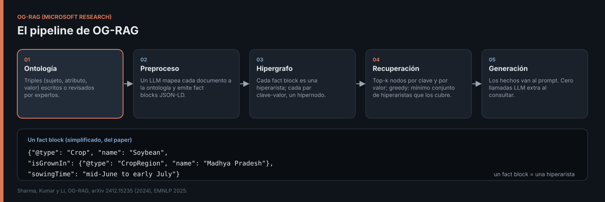
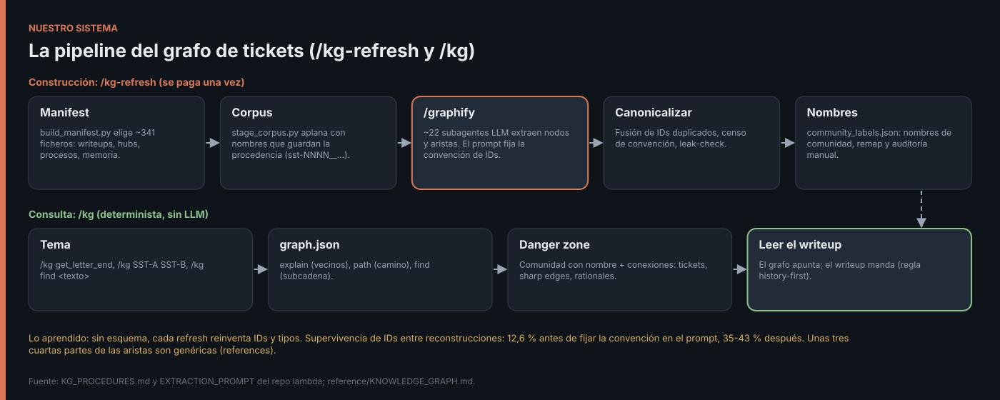
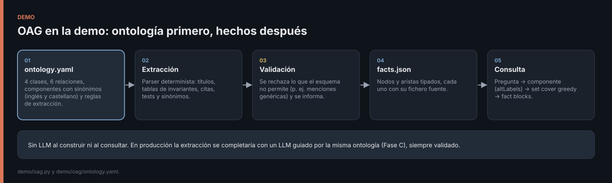
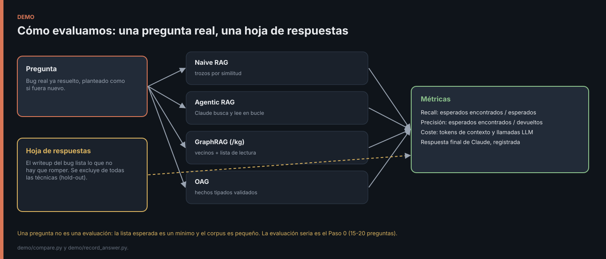

# Guía de la presentación y la demo: de Naive RAG a OAG

> English version: [DEMO_GUIDE.md](DEMO_GUIDE.md). Deck: `presentacion/OAG_vs_KG_Presentacion.pptx`
> (ES) y `presentacion/OAG_vs_KG_Presentation_EN.pptx` (EN). Diagramas: `docs/img/` (se regeneran con
> `python docs/img/build_diagrams.py --png`).

Esta guía sirve para presentar Ontology-Augmented Generation (OAG) y ejecutar la demo en directo con
Claude Code. Está ordenada como la sesión: primero los conceptos, después nuestro sistema, la demo, la
evaluación y, al final, cuándo conviene cada técnica.

## Guion

| Bloque | Contenido | Tiempo orientativo |
|---|---|---|
| 1 | Qué es OAG y por qué ahora | 5 min |
| 2 | Conceptos: ontología, hechos, schema-first | 10 min |
| 3 | De RAG a OAG y el pipeline de OG-RAG | 10 min |
| 4 | Nuestro grafo de tickets: qué hace y qué aprendimos | 10 min |
| 5 | Demo en directo: cinco skills | 20 min |
| 6 | Evaluación, resultados y cuándo usar cada técnica | 10 min |

---

## 1. Qué es OAG

Un modelo de lenguaje responde mejor cuando se le da el contexto adecuado. Retrieval-Augmented
Generation (RAG) busca ese contexto en documentos y lo añade al prompt (Lewis et al., 2020). La forma
básica recupera trozos de texto parecidos a la pregunta. Funciona, pero el modelo recibe fragmentos
sueltos y tiene que adivinar qué es un hecho, cómo se relacionan y de dónde sale cada cosa.

**Ontology-Augmented Generation** cambia la unidad de recuperación: en lugar de trozos de texto, el
sistema recupera **hechos tipados** que cumplen un esquema del dominio escrito de antemano, la
ontología. Recuperar y generar ocurren dentro de ese esquema: el dominio decide qué es un hecho, qué
relaciones existen y qué reglas deben cumplirse.

El término se usa con tres sentidos distintos, y conviene separarlos:

| Fuente | Qué entiende por OAG |
|---|---|
| Sharma, Kumar y Li, OG-RAG (Microsoft Research, EMNLP 2025) | Un método concreto y evaluado: documentos mapeados a la ontología como *fact blocks*, hipergrafo y recuperación por set cover |
| Palantir Foundry | Una práctica de plataforma: los documentos son objetos de una Ontología de negocio con objetos, enlaces y acciones |
| L. Huang, *From RAG to OAG* (Medium) | Un marco conceptual: la ontología como capa normativa (clases, relaciones, axiomas tipo OWL/SHACL) |

## 2. Conceptos principales


- **Ontología.** Especificación explícita y compartida de un dominio (Gruber, 1993): qué tipos de cosas
  existen, cómo se relacionan y qué reglas deben cumplir, escrita para que una máquina pueda usarla y
  validarla. No es una taxonomía ni una lista de etiquetas.
- **Clase.** Un tipo de cosa del dominio: `Ticket`, `Invariant`, `Component`, `Test`.
- **Relación.** Un enlace con nombre, dirección, dominio y rango: `Invariant guards Component`.
- **Atributo.** Una propiedad de una clase: título, estado, fichero fuente.
- **Restricción.** Lo que puede ser verdad: `guards` solo sale de un `Invariant`; toda arista tiene
  fuente. En la web semántica se expresan con OWL y se validan con SHACL (W3C).
- **Instancia o hecho.** Un dato concreto que cumple el esquema: `TKT-104 touches letter_end_detection`.
- **Sinónimos (altLabels).** Las palabras con las que el texto libre nombra un mismo concepto. Son la
  pieza que permite que `get_letter_end`, `LETTER_END_*` y «fin de carta» se traten como una sola cosa.
- **Fact block.** Un grupo de hechos sobre una entidad, en OG-RAG serializado como JSON-LD. Es la unidad
  que se recupera.
- **Hipergrafo.** Grafo en el que una arista (hiperarista) une más de dos nodos. En OG-RAG cada fact block
  es una hiperarista y cada par clave-valor un nodo.
- **Set cover.** Elegir el mínimo número de fact blocks que cubren todos los nodos relevantes para la
  pregunta. OG-RAG lo resuelve con un algoritmo greedy.
- **Schema-first frente a schema-emergent.** En OAG el esquema existe antes de extraer y la extracción
  se ciñe a él. En GraphRAG, y en nuestro grafo actual, el LLM decide los tipos al extraer.
- **Atribución.** Cada hecho apunta a su documento fuente, de modo que la respuesta se puede verificar.

## 3. De RAG a OAG


| Generación | Idea | Referencia |
|---|---|---|
| Naive RAG | Trocear, vectorizar, top-k por similitud | Lewis et al., 2020; Gao et al., 2023 |
| RAG + rerank | Un segundo modelo reordena lo recuperado | Gao et al., 2023 |
| Modular RAG | Reescritura de consulta, búsqueda híbrida, routing | Gao et al., 2023 |
| Agentic RAG | El agente planifica, recupera en bucle y se corrige | Singh et al., 2025 |
| GraphRAG | Grafo de entidades y resúmenes de comunidades extraídos por LLM | Edge et al., 2024 |
| OAG | Ontología previa que guía extracción, validación y recuperación | Sharma et al., 2024 |

### El pipeline de OG-RAG



1. **Ontología**: triples (sujeto, atributo, valor) escritos o revisados por expertos.
2. **Preproceso**: un LLM mapea cada documento a la ontología y emite fact blocks JSON-LD.
3. **Hipergrafo**: fact blocks como hiperaristas, pares clave-valor como nodos.
4. **Recuperación**: top-k nodos por similitud de clave y de valor; después, el mínimo conjunto de
   hiperaristas que los cubre.
5. **Generación**: los hechos van al prompt. No hay llamadas LLM extra al consultar.

Resultados publicados (Tabla 1 del paper, context recall):

| Dataset | RAG | RAPTOR | GraphRAG | OG-RAG |
|---|---|---|---|---|
| Soja | 0,22 | 0,54 | 0,41 | **0,84** |
| Trigo | 0,14 | 0,85 | 0,78 | **0,95** |
| Noticias | 0,01 | 0,82 | no terminó en un día | 0,82 |

Letra pequeña: datos propietarios, dos dominios, ontologías escritas a mano, y la relevancia de la
respuesta no siempre mejora (RAPTOR gana en trigo y noticias). La ganancia está en el recall de hechos;
el precio, construir y mantener la ontología.

## 4. Nuestro sistema: el grafo de tickets



El grafo indexa la memoria del proyecto (writeups por ticket, `SHARP_EDGES`, `STATUS`, `FOLLOWUPS`,
procesos de extractores, notas de memoria) para responder *qué se rompió antes y qué hay alrededor* de lo
que vamos a tocar. Complementa a CodeGraph, que responde *qué es el código y qué llama a qué*.

- **Construcción (`/kg-refresh`)**: un manifest elige unos 341 ficheros; se aplanan en un corpus; unos 22
  subagentes LLM (graphify) extraen nodos y aristas; se canonicalizan los IDs; se nombran las
  comunidades. Es caro, pero se paga una vez.
- **Consulta (`/kg`)**: determinista y sin LLM sobre `graph.json`: vecinos, camino entre dos tickets o
  búsqueda por texto. Devuelve la zona de peligro y una lista de lectura. El grafo apunta; el writeup
  manda.

### Lo que hemos aprendido (y por qué importa OAG)

Las cifras salen de `KG_PROCEDURES.md` del repo lambda:

- **Los IDs no sobreviven sin esquema.** En la reconstrucción del 2026-08-10 solo sobrevivió el 12,6 % de
  los IDs de nodo, porque cada extracción elegía su propio esquema de IDs. Al fijar la convención en el
  prompt de extracción la supervivencia subió al 35-43 %. Es un primer paso hacia schema-first.
- **El tamaño del grafo oscila entre reconstrucciones**: de 2.163 a 3.921 nodos con un corpus parecido,
  según cómo se troceó la extracción.
- **Nombrar comunidades cuesta en torno a una hora por refresh**, y solo se conserva del 31 al 46 % de los
  nombres. Hay que auditarlos a mano.
- **Las aristas son mayoritariamente genéricas**: unas tres cuartas partes son `references`. El grafo dice
  qué leer, no qué hecho aporta cada fichero.
- **Ya hay relaciones tipadas** donde la fuente es estructurada: las tablas de estado de tickets aportan
  `implemented_by`, `is_blocked_by`, `has_parent`. Es la parte que ya funciona como una ontología.

Conclusión: nuestro grafo hace aproximadamente la mitad de OAG (conocimiento en grafo, inferencia cara una
sola vez, atribución, uso antes de actuar). Le falta el esquema previo, la validación y devolver hechos.

## 5. La demo

Cinco skills de Claude Code responden a la misma pregunta real sobre el mismo corpus. Detalle técnico en
`demo/README.md`.

### Preparación (antes de la sesión)

```bash
git pull
pip install -r demo/requirements.txt
python demo/oag.py build
python demo/compare.py        # comprobación rápida de que todo responde
```

Los datos están en `data/` (fuera de git): corpus de kg, `graph.json` y `questions.yaml`.

### La pregunta

> Tengo que arreglar un bug nuevo: en una side letter DOCX el marcador de fin de carta va «run-in»
> (dentro de un párrafo, después de una cláusula), `get_letter_end` no lo detecta y el bloque de firma
> acaba dentro de la última provisión. ¿Qué tickets anteriores e invariantes tengo que respetar para no
> romper nada?

Es un bug real que ya se investigó. Su writeup contiene la lista de lo que no hay que romper, escrita por
quien lo resolvió. Esa lista es la hoja de respuestas, y el writeup se excluye de todas las técnicas.

### Paso a paso

| Skill | Qué enseñar | Qué decir |
|---|---|---|
| `/demo-naive-rag` | Los 5 trozos recuperados y los tickets que aparecen | Encuentra las palabras, no los hechos. No sabe qué ticket importa ni por qué |
| `/demo-agentic-rag` | Claude planificando, buscando y leyendo, paso a paso | Más precisión a cambio de pasos y tokens; cada ejecución es distinta |
| `/demo-graphrag` | Los vecinos de `get_letter_end`, sus tipos de arista y la lista de lectura | Barato y determinista. Dice qué leer; con dos saltos gana recall y pierde precisión |
| `/demo-oag` | `ontology.yaml`, el informe de validación (lo rechazado) y los fact blocks | El esquema primero. Cada hecho dice qué invariante origina, quién pide no romperlo y qué test lo fija |
| `/demo-compare` | La tabla final | Recall, precisión y coste, con sus límites |



En `/demo-oag` merece la pena enseñar tres cosas: los sinónimos del componente `letter_end_detection`
(por qué la pregunta encuentra el componente), las 31 menciones genéricas rechazadas por la validación
(por qué el grafo resultante es más limpio) y un fact block completo (qué recibe el modelo).

## 6. Cómo evaluamos



- **Respuesta esperada**: los tickets que el writeup del bug manda respetar (7 en la pregunta actual).
- **Hold-out**: el writeup y sus notas se excluyen del corpus, del grafo y de los hechos.
- **Recall** = esperados encontrados / esperados. **Precisión** = esperados encontrados / devueltos.
- **Qué cuenta como devuelto**: en Naive RAG, los tickets que aparecen en los trozos; en GraphRAG, los de
  los vecinos y la lista de lectura; en OAG, el sujeto de cada fact block y los orígenes de sus
  invariantes (no los tickets que solo figuran como procedencia).
- **Coste**: tokens de contexto y llamadas LLM al recuperar.
- **Respuesta de Claude**: cada skill registra la respuesta final; es la comparación que importa en
  directo.

Resultados con 14 ficheros del corpus (antes de copiar el corpus completo):

| Técnica | Recall | Precisión | Tokens de contexto | LLM al recuperar |
|---|---|---|---|---|
| Naive RAG | 100 % | 39 % | ~1.700 | 0 |
| GraphRAG (/kg, 1 salto) | 43 % | 43 % | ~370 | 0 |
| GraphRAG (/kg, 2 saltos) | 86 % | 23 % | mayor | 0 |
| OAG | 86 % | 60 % | ~1.400 | 0 |
| Agentic RAG | en directo | en directo | variable | varios pasos |

Cómo leerlos:

- Naive RAG acierta todo porque entra el índice de invariantes de `SHARP_EDGES`, que alguien ya escribió
  a mano: es una ontología implícita. Con el corpus completo la competencia por el top-k es mayor.
- OAG no encuentra uno de los siete tickets porque su invariante protege la detección de títulos, no el fin de carta. Es
  un fallo honesto del esquema, y se corrige con una relación o un componente más, no con más texto.
- Una sola pregunta no es una evaluación. La lista esperada es un mínimo: algunos «falsos positivos» de
  OAG (otros invariantes de fin de carta) son defendibles. La evaluación seria es el Paso 0 del
  `HANDOVER.md`: entre 15 y 20 preguntas con respuesta conocida.

## 7. Cuándo conviene cada técnica


| Técnica | Conviene cuando | Coste y riesgo |
|---|---|---|
| Sin RAG | Todo el contexto cabe en la ventana | Solo tokens |
| Naive RAG | Preguntas puntuales sobre mucho texto sin estructura | Barato; trozos sueltos y ruido |
| RAG + rerank / híbrido | Vocabulario variado o nombres exactos (IDs, símbolos) | Un modelo más |
| Agentic RAG | Preguntas exploratorias o de varios pasos | Más tokens y pasos; variabilidad |
| GraphRAG | Relaciones y temas globales; «qué hay alrededor de X» | Construcción cara; esquema inestable |
| OAG | Hechos tipados, reglas, auditoría, atribución | Escribir y mantener la ontología |

Regla práctica: empezar por lo más simple que responda las preguntas reales y medir antes de subir de
nivel. Una ontología grande «por completitud» es el principal riesgo de OAG.

## 8. Lecciones para los skills de la metodología

Lo que la demo sugiere para `/kg`, `/kg-refresh` y las plantillas:

1. **Medir antes de cambiar**: convertir la pregunta de la demo en las primeras de un set de 15-20 con
   respuesta conocida (Paso 0) y medir el grafo actual.
2. **Escribir la ontología mínima** a partir de las plantillas (Fase A): la de la demo
   (`demo/oag/ontology.yaml`) es un punto de partida.
3. **Backbone determinista** (Fase B): frontmatter en las plantillas de ticket y sharp edges, y parseo
   de tablas e IDs. La demo extrae así el 100 % de sus hechos, sin LLM.
4. **Extracción guiada y validada** (Fase C): pasar la ontología a los subagentes de graphify y rechazar
   en `finalize` lo que no cumpla el esquema. Es la continuación natural de fijar la convención de IDs.
5. **`/kg facts <tema>`** (Fase D): devolver fact blocks con su fuente, además de la lista de lectura.

## Referencias

- P. Lewis et al., *Retrieval-Augmented Generation for Knowledge-Intensive NLP Tasks*, NeurIPS 2020.
  [arXiv 2005.11401](https://arxiv.org/abs/2005.11401)
- Y. Gao et al., *Retrieval-Augmented Generation for Large Language Models: A Survey*, 2023.
  [arXiv 2312.10997](https://arxiv.org/abs/2312.10997)
- A. Singh et al., *Agentic Retrieval-Augmented Generation: A Survey on Agentic RAG*, 2025.
  [arXiv 2501.09136](https://arxiv.org/abs/2501.09136)
- D. Edge et al., *From Local to Global: A GraphRAG Approach to Query-Focused Summarization*, 2024.
  [arXiv 2404.16130](https://arxiv.org/abs/2404.16130)
- P. Sarthi et al., *RAPTOR: Recursive Abstractive Processing for Tree-Organized Retrieval*, ICLR 2024.
  [arXiv 2401.18059](https://arxiv.org/abs/2401.18059)
- K. Sharma, P. Kumar, Y. Li, *OG-RAG: Ontology-Grounded Retrieval-Augmented Generation for Large
  Language Models*, 2024; EMNLP 2025. [arXiv 2412.15235](https://arxiv.org/abs/2412.15235),
  [ACL Anthology](https://aclanthology.org/2025.emnlp-main.1674/)
- Palantir, *Ontology augmented generation*.
  [Documentación de Foundry](https://www.palantir.com/docs/foundry/ontology/ontology-augmented-generation)
- L. Huang, *From RAG to OAG*. [Medium](https://medium.com/@linghuang_76674/from-rag-to-oag-68e3ac807c29)
- T. R. Gruber, *A translation approach to portable ontology specifications*, Knowledge Acquisition 5(2),
  1993.
- W3C, *OWL 2 Web Ontology Language Overview*. [w3.org/TR/owl2-overview](https://www.w3.org/TR/owl2-overview/)
- W3C, *Shapes Constraint Language (SHACL)*. [w3.org/TR/shacl](https://www.w3.org/TR/shacl/)
- Material del proyecto: `docs/OAG_VS_KG.md`, `HANDOVER.md`, `reference/KNOWLEDGE_GRAPH.md`,
  `demo/README.md`.
