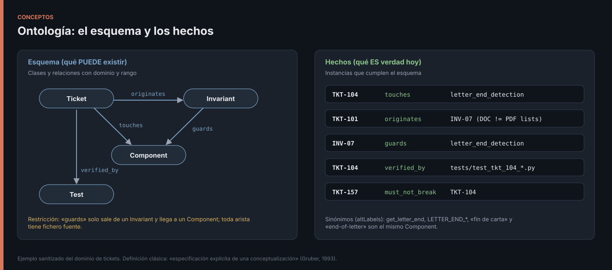
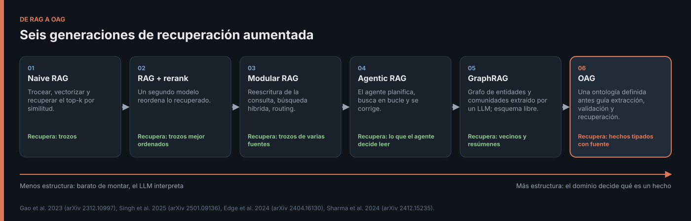
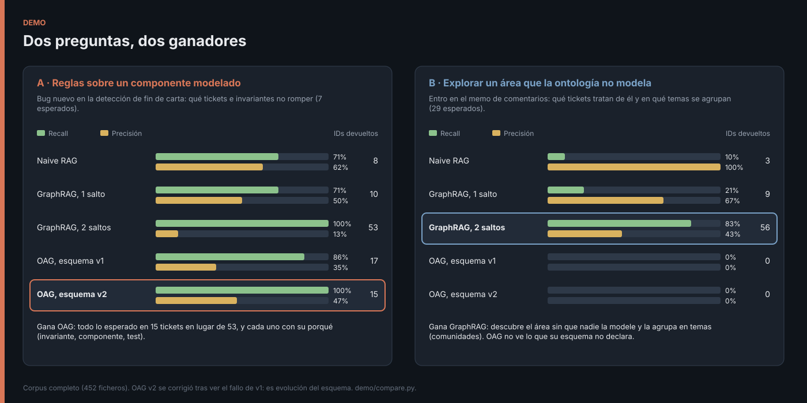
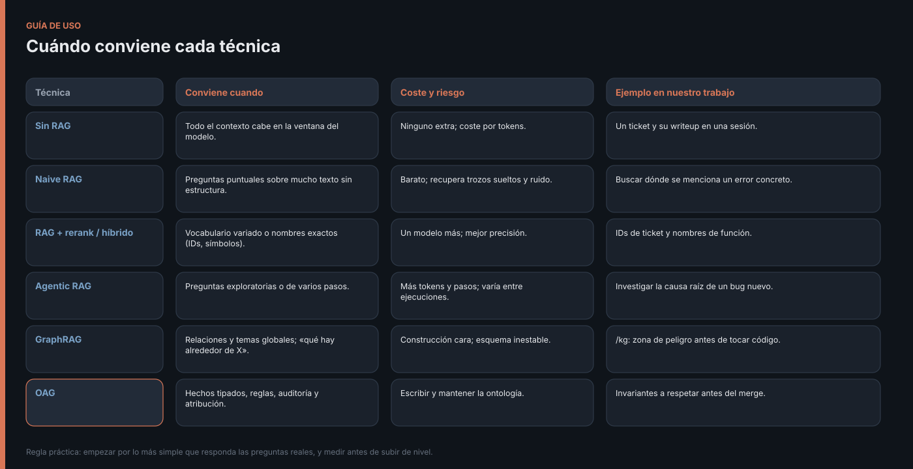

# Guía de la presentación y la demo: de Naive RAG a OAG

> English version: [DEMO_GUIDE.md](DEMO_GUIDE.md). Detalle técnico (qué se ejecuta y dónde):
> [GUIA_TECNICA.md](GUIA_TECNICA.md). Deck: `presentacion/OAG_vs_KG_Presentacion.pptx`
> (ES) y `presentacion/OAG_vs_KG_Presentation_EN.pptx` (EN). Diagramas: `docs/img/` (se regeneran con
> `python docs/img/build_diagrams.py --png`).

Esta guía sirve para presentar Ontology-Augmented Generation (OAG) y ejecutar la demo en directo con
Claude Code. Está ordenada como la sesión: primero los conceptos, después nuestro sistema, la demo, la
evaluación y, al final, cuándo conviene cada técnica.

## Guion

| Bloque | Contenido | Tiempo orientativo |
|---|---|---|
| 1 | Qué es OAG y por qué ahora | 5 min |
| 2 | Conceptos: ontología, hechos, schema-first | 10 min |
| 3 | De RAG a OAG y el pipeline de OG-RAG | 10 min |
| 4 | Nuestro grafo de tickets: qué hace y qué aprendimos | 10 min |
| 5 | Demo en directo: dos preguntas, cinco skills | 25 min |
| 6 | Evaluación, resultados, dónde gana cada técnica y si merece la pena | 15 min |

---

## 1. Qué es OAG

Un modelo de lenguaje responde mejor cuando se le da el contexto adecuado. Retrieval-Augmented
Generation (RAG) busca ese contexto en documentos y lo añade al prompt (Lewis et al., 2020). La forma
básica recupera trozos de texto parecidos a la pregunta. Funciona, pero el modelo recibe fragmentos
sueltos y tiene que adivinar qué es un hecho, cómo se relacionan y de dónde sale cada cosa.

**Ontology-Augmented Generation** cambia la unidad de recuperación: en lugar de trozos de texto, el
sistema recupera **hechos tipados** que cumplen un esquema del dominio escrito de antemano, la
ontología. Recuperar y generar ocurren dentro de ese esquema: el dominio decide qué es un hecho, qué
relaciones existen y qué reglas deben cumplirse.

El término se usa con tres sentidos distintos, y conviene separarlos:

| Fuente | Qué entiende por OAG |
|---|---|
| Sharma, Kumar y Li, OG-RAG (Microsoft Research, EMNLP 2025) | Un método concreto y evaluado: documentos mapeados a la ontología como *fact blocks*, hipergrafo y recuperación por set cover |
| Palantir Foundry | Una práctica de plataforma: los documentos son objetos de una Ontología de negocio con objetos, enlaces y acciones |
| L. Huang, *From RAG to OAG* (Medium) | Un marco conceptual: la ontología como capa normativa (clases, relaciones, axiomas tipo OWL/SHACL) |

## 2. Conceptos principales



- **Ontología.** Especificación explícita y compartida de un dominio (Gruber, 1993): qué tipos de cosas
  existen, cómo se relacionan y qué reglas deben cumplir, escrita para que una máquina pueda usarla y
  validarla. No es una taxonomía ni una lista de etiquetas.
- **Clase.** Un tipo de cosa del dominio: `Ticket`, `Invariant`, `Component`, `Test`.
- **Relación.** Un enlace con nombre, dirección, dominio y rango: `Invariant guards Component`.
- **Atributo.** Una propiedad de una clase: título, estado, fichero fuente.
- **Restricción.** Lo que puede ser verdad: `guards` solo sale de un `Invariant`; toda arista tiene
  fuente. En la web semántica se expresan con OWL y se validan con SHACL (W3C).
- **Instancia o hecho.** Un dato concreto que cumple el esquema: `TKT-104 touches letter_end_detection`.
- **Sinónimos (altLabels).** Las palabras con las que el texto libre nombra un mismo concepto. Son la
  pieza que permite que `get_letter_end`, `LETTER_END_*` y «fin de carta» se traten como una sola cosa.
- **Fact block.** Un grupo de hechos sobre una entidad, en OG-RAG serializado como JSON-LD. Es la unidad
  que se recupera.
- **Hipergrafo.** Grafo en el que una arista (hiperarista) une más de dos nodos. En OG-RAG cada fact block
  es una hiperarista y cada par clave-valor un nodo.
- **Set cover.** Elegir el mínimo número de fact blocks que cubren todos los nodos relevantes para la
  pregunta. OG-RAG lo resuelve con un algoritmo greedy.
- **Schema-first frente a schema-emergent.** En OAG el esquema existe antes de extraer y la extracción
  se ciñe a él. En GraphRAG, y en nuestro grafo actual, el LLM decide los tipos al extraer.
- **Atribución.** Cada hecho apunta a su documento fuente, de modo que la respuesta se puede verificar.

## 3. De RAG a OAG



| Generación | Idea | Referencia |
|---|---|---|
| Naive RAG | Trocear, vectorizar, top-k por similitud | Lewis et al., 2020; Gao et al., 2023 |
| RAG + rerank | Un segundo modelo reordena lo recuperado | Gao et al., 2023 |
| Modular RAG | Reescritura de consulta, búsqueda híbrida, routing | Gao et al., 2023 |
| Agentic RAG | El agente planifica, recupera en bucle y se corrige | Singh et al., 2025 |
| GraphRAG | Grafo de entidades y resúmenes de comunidades extraídos por LLM | Edge et al., 2024 |
| OAG | Ontología previa que guía extracción, validación y recuperación | Sharma et al., 2024 |

### El pipeline de OG-RAG


1. **Ontología**: triples (sujeto, atributo, valor) escritos o revisados por expertos.
2. **Preproceso**: un LLM mapea cada documento a la ontología y emite fact blocks JSON-LD.
3. **Hipergrafo**: fact blocks como hiperaristas, pares clave-valor como nodos.
4. **Recuperación**: top-k nodos por similitud de clave y de valor; después, el mínimo conjunto de
   hiperaristas que los cubre.
5. **Generación**: los hechos van al prompt. No hay llamadas LLM extra al consultar.

Resultados publicados (Tabla 1 del paper, context recall):

| Dataset | RAG | RAPTOR | GraphRAG | OG-RAG |
|---|---|---|---|---|
| Soja | 0,22 | 0,54 | 0,41 | **0,84** |
| Trigo | 0,14 | 0,85 | 0,78 | **0,95** |
| Noticias | 0,01 | 0,82 | no terminó en un día | 0,82 |

Letra pequeña: datos propietarios, dos dominios, ontologías escritas a mano, y la relevancia de la
respuesta no siempre mejora (RAPTOR gana en trigo y noticias). La ganancia está en el recall de hechos;
el precio, construir y mantener la ontología.

## 4. Nuestro sistema: el grafo de tickets


El grafo indexa la memoria del proyecto (writeups por ticket, `SHARP_EDGES`, `STATUS`, `FOLLOWUPS`,
procesos de extractores, notas de memoria) para responder *qué se rompió antes y qué hay alrededor* de lo
que vamos a tocar. Complementa a CodeGraph, que responde *qué es el código y qué llama a qué*.

- **Construcción (`/kg-refresh`)**: un manifest elige unos 341 ficheros; se aplanan en un corpus; unos 22
  subagentes LLM (graphify) extraen nodos y aristas; se canonicalizan los IDs; se nombran las
  comunidades. Es caro, pero se paga una vez.
- **Consulta (`/kg`)**: determinista y sin LLM sobre `graph.json`: vecinos, camino entre dos tickets o
  búsqueda por texto. Devuelve la zona de peligro y una lista de lectura. El grafo apunta; el writeup
  manda.

### Lo que hemos aprendido (y por qué importa OAG)

Las cifras salen de `KG_PROCEDURES.md` del repo lambda:

- **Los IDs no sobreviven sin esquema.** En la reconstrucción del 2026-08-10 solo sobrevivió el 12,6 % de
  los IDs de nodo, porque cada extracción elegía su propio esquema de IDs. Al fijar la convención en el
  prompt de extracción la supervivencia subió al 35-43 %. Es un primer paso hacia schema-first.
- **El tamaño del grafo oscila entre reconstrucciones**: de 2.163 a 3.921 nodos con un corpus parecido,
  según cómo se troceó la extracción.
- **Nombrar comunidades cuesta en torno a una hora por refresh**, y solo se conserva del 31 al 46 % de los
  nombres. Hay que auditarlos a mano.
- **Las aristas son mayoritariamente genéricas**: unas tres cuartas partes son `references`. El grafo dice
  qué leer, no qué hecho aporta cada fichero.
- **Ya hay relaciones tipadas** donde la fuente es estructurada: las tablas de estado de tickets aportan
  `implemented_by`, `is_blocked_by`, `has_parent`. Es la parte que ya funciona como una ontología.

Conclusión: nuestro grafo hace aproximadamente la mitad de OAG (conocimiento en grafo, inferencia cara una
sola vez, atribución, uso antes de actuar). Le falta el esquema previo, la validación y devolver hechos.

## 5. La demo

Cinco skills de Claude Code responden a las mismas preguntas reales sobre el mismo corpus. La demo no
busca un ganador absoluto: tiene dos preguntas elegidas para enseñar dónde gana cada técnica y por qué.
Detalle técnico en `demo/README.md`.

### Preparación (antes de la sesión)

```bash
git pull
uv sync && source .venv/bin/activate
uv sync --group embed        # opcional: capa semántica (pregunta en castellano)
python demo/oag.py build --q letter-end-runin
python demo/oag.py build --q comment-memo-landscape
python demo/compare.py        # comprobación rápida de que todo responde
```

Los datos están en `data/` (fuera de git): el corpus completo de kg, `graph.json`, los nombres de las
comunidades y `questions.yaml`.

### Las dos preguntas

**A. Reglas sobre un componente modelado** (`letter-end-runin`, se espera que gane OAG):

> Tengo que arreglar un bug nuevo: en una side letter DOCX el marcador de fin de carta va «run-in»
> (dentro de un párrafo, después de una cláusula), `get_letter_end` no lo detecta y el bloque de firma
> acaba dentro de la última provisión. ¿Qué tickets anteriores e invariantes tengo que respetar para no
> romper nada?

Es un bug real que ya se investigó. Su writeup contiene la lista de lo que no hay que romper, escrita por
quien lo resolvió. Esa lista es la hoja de respuestas, y el writeup se excluye de todas las técnicas.

**B. Explorar un área que la ontología no modela** (`comment-memo-landscape`, se espera que gane
GraphRAG):

> Empiezo a trabajar en el extractor del memo de comentarios y no lo conozco. ¿Qué tickets anteriores
> tratan de él y en qué temas se agrupan?

La respuesta esperada sale de una regla objetiva: todos los writeups cuyo título menciona el memo de
comentarios (29). La ontología de la demo no tiene ese componente, a propósito: es lo que pasa con
cualquier área que nadie ha modelado todavía.

### Paso a paso

Pregunta A:

| Skill | Qué enseñar | Qué decir |
|---|---|---|
| `/demo-naive-rag` | Los 5 trozos recuperados y los tickets que aparecen | Encuentra las palabras, no los hechos. No sabe qué ticket importa ni por qué |
| `/demo-agentic-rag` | Claude planificando, buscando y leyendo, paso a paso | Más precisión a cambio de pasos y tokens; cada ejecución es distinta |
| `/demo-graphrag` | Los vecinos de `get_letter_end`, sus tipos de arista y la lista de lectura | Barato y determinista. Dice qué leer; con dos saltos lo encuentra todo, pero entre 53 tickets |
| `/demo-oag` | `ontology.yaml`, lo rechazado por la validación y los fact blocks, con v1 y v2 | El esquema primero. Cada hecho dice qué invariante origina, quién pide no romperlo y qué test lo fija |

Pregunta B:

| Skill | Qué enseñar | Qué decir |
|---|---|---|
| `/demo-graphrag comment-memo-landscape` | Vecinos del extractor a dos saltos y los temas (comunidades con nombre) | Nadie ha modelado esta área y el grafo la encuentra y la agrupa |
| `/demo-oag comment-memo-landscape` | La consulta sin componentes y sin hechos | OAG solo ve lo que su esquema declara. Para cubrir el área hay que modelarla primero |
| `/demo-compare` | Las tablas en inglés y en castellano llano | Dónde gana cada una, con sus límites |

Pregunta en castellano llano (opcional, apartado 6):

| Skill | Qué enseñar | Qué decir |
|---|---|---|
| `/demo-oag --lang es` | Sin componentes con v2; con v3 o `--semantic`, los mismos hechos que en inglés | El idioma solo afecta al primer paso: reconocer de qué componente se habla |
| `/demo-graphrag --lang es --semantic` | Los candidatos a semilla con su similitud | El modelo encuentra la zona; el nodo central lo sigue eligiendo quien conoce el dominio |


En `/demo-oag` merece la pena enseñar cuatro cosas: los sinónimos del componente `letter_end_detection`
(por qué la pregunta encuentra el componente), las menciones genéricas rechazadas por la validación (por
qué el grafo resultante es más limpio), un fact block completo (qué recibe el modelo) y la diferencia
entre el esquema v1 y el v2 (siguiente apartado).

### De OAG v1 a v2: el esquema también se depura

La primera ontología fallaba en la pregunta A de dos formas, y las dos eran del esquema, no de la
técnica:

1. **Ruido por una relación sin restricción.** `must_not_break` traía tickets que un writeup de fin de
   carta pide no romper, pero que pertenecen a otras áreas (numeración, PDF). La v2 añade una
   restricción, al estilo de SHACL: el ticket protegido debe compartir componente con la pregunta. Pasa
   de 17 a 11 tickets sin perder ninguno esperado.
2. **Una dependencia que no estaba declarada.** La detección de fin de carta usa `get_titles` para mirar
   el título siguiente (lo dice un invariante de `SHARP_EDGES`), pero la v1 trataba los componentes como
   islas. La v2 añade la relación `calls` (fin de carta llama a `get_titles`) y recupera el invariante
   que faltaba.

`python demo/oag.py query --schema 1` reproduce la v1. Hay que contarlo con honestidad: la v2 se escribió
después de ver qué fallaba. Es la forma normal de mantener una ontología, pero el resultado solo se puede
atribuir a la técnica cuando se valide con preguntas nuevas.

## 6. Cómo evaluamos


- **Respuesta esperada**: en la pregunta A, los tickets que el writeup del bug manda respetar (7); en la
  B, los writeups cuyo título menciona el área (29), una regla objetiva y no una lista elegida a mano.
- **Hold-out**: en la pregunta A, el writeup y sus notas se excluyen del corpus, del grafo y de los
  hechos. La B no tiene hoja de respuestas que esconder.
- **Recall** = esperados encontrados / esperados. **Precisión** = esperados encontrados / devueltos.
  **F1** = media armónica de las dos.
- **Qué cuenta como devuelto**: en Naive RAG, los tickets que aparecen en los trozos; en GraphRAG, los de
  los vecinos y la lista de lectura; en OAG, el sujeto de cada fact block y los orígenes de sus
  invariantes (no los tickets que solo figuran como procedencia).
- **Coste**: tokens de contexto y llamadas LLM al recuperar.
- **Respuesta de Claude**: cada skill registra la respuesta final; es la comparación que importa en
  directo.

Resultados con el corpus completo (452 ficheros tras el hold-out) y el grafo reconstruido el 20 de
noviembre.



**Pregunta A: reglas sobre un componente modelado** (7 esperados). La última columna es la primera
prueba, con 14 ficheros y el grafo anterior:

| Técnica | Recall | Precisión | F1 | IDs | Tokens de contexto | Con 14 ficheros (R / P) |
|---|---|---|---|---|---|---|
| Naive RAG | 71 % | 62 % | 0,67 | 8 | ~1.600 | 100 % / 39 % |
| GraphRAG (/kg, 1 salto) | 71 % | 50 % | 0,59 | 10 | ~770 | 43 % / 43 % |
| GraphRAG (/kg, 2 saltos) | 100 % | 13 % | 0,23 | 53 | ~7.000 | 86 % / 23 % |
| OAG, esquema v1 | 86 % | 35 % | 0,50 | 17 | ~2.000 | 86 % / 60 % |
| OAG, esquema v2 | 100 % | 47 % | 0,64 | 15 | ~2.500 | - |
| Agentic RAG | en directo | en directo | - | variable | variable | - |

**Pregunta B: explorar un área que la ontología no modela** (29 esperados):

| Técnica | Recall | Precisión | F1 | IDs | Tokens de contexto |
|---|---|---|---|---|---|
| Naive RAG | 10 % | 100 % | 0,19 | 3 | ~1.600 |
| GraphRAG (/kg, 1 salto) | 21 % | 67 % | 0,32 | 9 | ~1.100 |
| GraphRAG (/kg, 2 saltos) | 83 % | 43 % | 0,56 | 56 | ~7.000 |
| OAG, esquema v1 y v2 | 0 % | - | 0 | 0 | 0 |
| Agentic RAG | en directo | en directo | - | variable | variable |

Ninguna técnica llama a un LLM para recuperar, salvo Agentic RAG, que es el propio Claude buscando.

Cómo leerlos:

- **En la pregunta A gana OAG v2, y conviene decir en qué.** Es la única técnica que encuentra los siete
  tickets sin traer otros 46: GraphRAG a dos saltos también llega al 100 %, pero entre 53. Por F1, Naive
  RAG queda a la par, porque devuelve poco; pero se deja dos de los siete, y en una pregunta de «qué no
  romper» un olvido es una regresión. Además, cada fact block dice por qué el ticket importa
  (invariante, componente y test), algo que ni los trozos ni la lista de lectura dicen.
- **En la pregunta B gana GraphRAG.** Descubre el área sin que nadie la haya modelado y la agrupa en temas
  con las comunidades del grafo (rutas de extracción, modo documento, vocabulario de estados, fronteras
  de cadena, cabeceras de tabla...). OAG no devuelve nada, porque la pregunta no menciona ningún
  componente de su ontología: no falla con ruido, falla en silencio. Naive RAG acierta en lo poco que
  devuelve, pero un top-5 no puede responder «todo lo que hay sobre X».
- **Naive RAG pierde recall al crecer el corpus** (100 % con 14 ficheros, 71 % con 452). Con pocos
  ficheros entraba el índice de `SHARP_EDGES`, que ya es una ontología implícita escrita a mano.
- **Dos preguntas no son una evaluación.** La lista esperada es un mínimo y OAG v2 se corrigió tras ver el
  fallo. La evaluación seria es el Paso 0 del `HANDOVER.md`: entre 15 y 20 preguntas con respuesta
  conocida, mezclando los dos tipos.

### La misma pregunta en castellano llano: la capa semántica

El corpus está en inglés y las tres técnicas deterministas comparan palabras: TF-IDF en Naive RAG, nombres
de nodo en GraphRAG y sinónimos de la ontología en OAG. Las preguntas de arriba funcionan porque llevan
identificadores (`get_letter_end`, «comment memo») y porque los scripts buscan con una versión en inglés
(`query`, `topic`). Para ver qué pasa cuando alguien pregunta como habla, cada pregunta tiene una versión
en castellano llano, sin nombres de código (`pregunta_llana`), y un tema en castellano para GraphRAG
(`tema`). Todos los scripts aceptan `--lang es`.

Después se añade una capa semántica: un modelo de embeddings multilingüe
(`paraphrase-multilingual-MiniLM-L12-v2`, unos 470 MB, funciona en CPU) que coloca «fin de carta» cerca de
«letter end». Cada técnica lo usa solo en el paso donde compara la pregunta con el corpus:

- **Naive RAG** ordena los trozos por similitud de significado (`--embed`).
- **GraphRAG** elige la semilla por similitud con las etiquetas de los nodos (`--semantic`).
- **OAG** elige los componentes por similitud con sus etiquetas (`--semantic`). La alternativa sin modelo
  es escribir sinónimos en castellano en la ontología (esquema v3, `--schema 3`).

**Pregunta A en castellano llano** (7 esperados):

| Técnica | Recall | Precisión | F1 | IDs |
|---|---|---|---|---|
| Naive RAG, TF-IDF | 14 % | 25 % | 0,18 | 4 |
| Naive RAG, embeddings | 43 % | 38 % | 0,40 | 8 |
| GraphRAG (1 salto), semilla por nombre | 0 % | - | 0 | 0 |
| GraphRAG (1 salto), semilla por similitud | 43 % | 75 % | 0,55 | 4 |
| OAG v2, etiquetas en inglés | 0 % | - | 0 | 0 |
| OAG v3, etiquetas en castellano | 100 % | 47 % | 0,64 | 15 |
| OAG v2, componentes por similitud | 100 % | 47 % | 0,64 | 15 |

**Pregunta B en castellano llano** (29 esperados):

| Técnica | Recall | Precisión | F1 | IDs |
|---|---|---|---|---|
| Naive RAG, TF-IDF | 0 % | 0 % | 0 | 3 |
| Naive RAG, embeddings | 10 % | 50 % | 0,17 | 6 |
| GraphRAG (2 saltos), semilla por nombre | 0 % | - | 0 | 0 |
| GraphRAG (2 saltos), semilla por similitud | 59 % | 25 % | 0,35 | 68 |
| OAG (v2, v3 o por similitud) | 0 % | - | 0 | 0 |

Cómo leerlos:

- **Sin capa semántica, las tres técnicas caen.** GraphRAG no encuentra ningún nodo que se llame «detección
  del fin de carta» y OAG no reconoce ningún componente. Es un fallo silencioso: ninguna avisa de que no ha
  entendido la pregunta, simplemente no devuelve nada.
- **En la pregunta A, OAG se recupera entero con cualquiera de los dos arreglos**: seis sinónimos en
  castellano en el YAML o el modelo eligiendo el componente. Una vez identificado el componente, el resto
  de OAG no depende del idioma y los hechos son los mismos que en inglés.
- **GraphRAG con semilla semántica cae en la zona correcta, pero no en el mejor nodo.** En A elige
  `letter-end look-ahead` en lugar de `get_letter_end`; en B, «Comment memo upload and extraction» (similitud
  0,89) en lugar de `CommentMemoExtractor`, y se queda en 59 % frente al 83 % de la semilla elegida a mano.
  El modelo entiende el tema; saber cuál es el nodo central sigue siendo conocimiento del dominio.
- **Los embeddings no son mejores en todo.** En castellano, Naive RAG mejora claramente; en inglés, en la
  pregunta A, los embeddings dan 57 % frente al 71 % de TF-IDF (en la B, 28 % frente a 10 %). En un corpus
  técnico lleno de identificadores, la coincidencia exacta de palabras pesa.
- **En la pregunta B, OAG sigue vacío también con la capa semántica, y es lo correcto.** El umbral impide
  asociar el memo de comentarios a un componente que no lo es (la similitud máxima es 0,35). La capa
  semántica no crea conocimiento que la ontología no tiene.
- **El umbral de OAG (0,42) está calibrado con estas dos preguntas**: es el punto medio entre el componente
  correcto (0,47) y el mejor incorrecto (0,38) de la pregunta A. Con tan pocos datos es un ajuste a medida;
  con el set del Paso 0 habría que fijarlo con preguntas no vistas. Los sinónimos de v3 no tienen ese
  problema, pero solo cubren las palabras que alguien ha escrito.

Coste: el modelo se descarga una vez y los embeddings del corpus se guardan en caché (`data/cache/`). La
primera ejecución tarda unos minutos en CPU; las siguientes, segundos.

## 7. Cuándo conviene cada técnica



| Técnica | Conviene cuando | Coste y riesgo |
|---|---|---|
| Sin RAG | Todo el contexto cabe en la ventana | Solo tokens |
| Naive RAG | Preguntas puntuales sobre mucho texto sin estructura | Barato; trozos sueltos y ruido |
| RAG + rerank / híbrido | Vocabulario variado o nombres exactos (IDs, símbolos) | Un modelo más |
| Agentic RAG | Preguntas exploratorias o de varios pasos | Más tokens y pasos; variabilidad |
| GraphRAG | Relaciones y temas globales; «qué hay alrededor de X» | Construcción cara; esquema inestable |
| OAG | Hechos tipados, reglas, auditoría, atribución | Escribir y mantener la ontología |

Regla práctica: empezar por lo más simple que responda las preguntas reales y medir antes de subir de
nivel. Una ontología grande «por completitud» es el principal riesgo de OAG.

### Dónde gana cada una en nuestra demo

| Si la pregunta es... | Usa | Porque |
|---|---|---|
| «Qué reglas, tickets o tests protegen este componente» | OAG | Hechos tipados con su porqué; poco ruido; validable antes de llegar al LLM |
| «Qué hay sobre esta área y cómo se organiza» | GraphRAG (/kg) | Descubre estructura sin esquema previo y agrupa en temas |
| «Dónde se menciona este identificador» | Naive RAG o búsqueda | Barato e inmediato; no necesita estructura |
| «Investiga este problema nuevo» | Agentic RAG | Planifica y vuelve a buscar; caro y variable |
| Cualquiera de las anteriores, en castellano y sin nombres de código | La misma, con capa semántica | Sinónimos en la ontología o embeddings multilingües en el primer paso |

OAG no sustituye a GraphRAG: lo completa. GraphRAG descubre la estructura; OAG fija la parte estable
como contrato y responde con hechos verificables.

## 8. Lecciones para los skills de la metodología

### ¿Merece la pena el esfuerzo en nuestro caso?

Sí, si se adopta por partes y solo para las preguntas de reglas. Lo que ha costado la demo:

- **La ontología**: 4 clases, 6 relaciones, 1 restricción y 4 componentes con sus sinónimos en inglés y
  en castellano, unas 70 líneas de YAML. Buena parte sale de las plantillas que ya usamos (ISSUE_NOTE,
  SHARP_EDGES, TEST_MAP).
- **La extracción**: determinista, sin LLM. Parsea tablas, viñetas e IDs; no hay coste por consulta ni
  por reconstrucción.
- **El mantenimiento**: cada área nueva que queramos consultar con OAG necesita su componente y sus
  sinónimos; cada fallo como el de v1 se corrige con una regla o una relación. Ese es el precio, y es
  pequeño mientras la ontología se limite a lo que preguntamos de verdad.

Lo que no merece la pena: modelar todo el dominio «por completitud» o sustituir `/kg`. Las preguntas de
exploración las sigue respondiendo mejor el grafo.

### Qué llevar a `/kg`, `/kg-refresh` y las plantillas

1. **Medir antes de cambiar**: convertir las dos preguntas de la demo en las primeras de un set de 15-20
   con respuesta conocida (Paso 0), mezclando preguntas de reglas y de exploración.
2. **Escribir la ontología mínima** a partir de las plantillas (Fase A), empezando por los componentes
   con más invariantes en `SHARP_EDGES`. La de la demo (`demo/oag/ontology.yaml`) es el punto de partida.
3. **Declarar las dependencias entre componentes** (`calls`): es lo que faltaba en la v1 y lo que un
   grafo emergente no da tipado.
4. **Backbone determinista** (Fase B): frontmatter en las plantillas de ticket y sharp edges, y parseo de
   tablas e IDs. La demo extrae así el 100 % de sus hechos, sin LLM.
5. **Extracción guiada y validada** (Fase C): pasar la ontología a los subagentes de graphify y rechazar
   en `finalize` lo que no cumpla el esquema. Es la continuación natural de fijar la convención de IDs.
6. **Preguntas en castellano**: sinónimos en castellano para los componentes de la ontología (baratos,
   deterministas y revisables) y un modelo de embeddings multilingüe pequeño para la semilla de `/kg` y la
   búsqueda de texto. No hace falta un modelo grande ni un servicio externo.
7. **Dos modos en `/kg`** (Fase D): `/kg facts <componente>` devuelve fact blocks con su fuente para
   preguntas de reglas; `/kg <tema>` sigue devolviendo vecinos, temas y lista de lectura para explorar.

## Referencias

- P. Lewis et al., *Retrieval-Augmented Generation for Knowledge-Intensive NLP Tasks*, NeurIPS 2020.
  [arXiv 2005.11401](https://arxiv.org/abs/2005.11401)
- Y. Gao et al., *Retrieval-Augmented Generation for Large Language Models: A Survey*, 2023.
  [arXiv 2312.10997](https://arxiv.org/abs/2312.10997)
- A. Singh et al., *Agentic Retrieval-Augmented Generation: A Survey on Agentic RAG*, 2025.
  [arXiv 2501.09136](https://arxiv.org/abs/2501.09136)
- D. Edge et al., *From Local to Global: A GraphRAG Approach to Query-Focused Summarization*, 2024.
  [arXiv 2404.16130](https://arxiv.org/abs/2404.16130)
- P. Sarthi et al., *RAPTOR: Recursive Abstractive Processing for Tree-Organized Retrieval*, ICLR 2024.
  [arXiv 2401.18059](https://arxiv.org/abs/2401.18059)
- K. Sharma, P. Kumar, Y. Li, *OG-RAG: Ontology-Grounded Retrieval-Augmented Generation for Large
  Language Models*, 2024; EMNLP 2025. [arXiv 2412.15235](https://arxiv.org/abs/2412.15235),
  [ACL Anthology](https://aclanthology.org/2025.emnlp-main.1674/)
- Palantir, *Ontology augmented generation*.
  [Documentación de Foundry](https://www.palantir.com/docs/foundry/ontology/ontology-augmented-generation)
- L. Huang, *From RAG to OAG*. [Medium](https://medium.com/@linghuang_76674/from-rag-to-oag-68e3ac807c29)
- T. R. Gruber, *A translation approach to portable ontology specifications*, Knowledge Acquisition 5(2),
  1993.
- W3C, *OWL 2 Web Ontology Language Overview*. [w3.org/TR/owl2-overview](https://www.w3.org/TR/owl2-overview/)
- W3C, *Shapes Constraint Language (SHACL)*. [w3.org/TR/shacl](https://www.w3.org/TR/shacl/)
- Material del proyecto: `docs/OAG_VS_KG.md`, `HANDOVER.md`, `reference/KNOWLEDGE_GRAPH.md`,
  `demo/README.md`.
