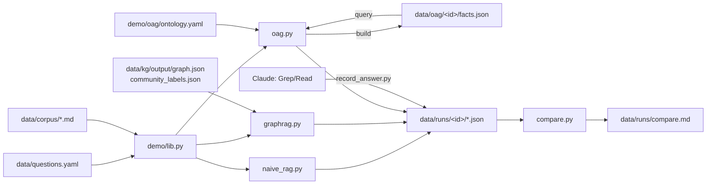

# Guía técnica de la demo: qué se ejecuta y dónde está

> English version: [TECHNICAL_GUIDE.md](TECHNICAL_GUIDE.md). Guía para presentar la demo:
> [GUIA_DEMO.md](GUIA_DEMO.md). Referencia rápida de uso: [`demo/README.md`](../demo/README.md).

Esta guía explica, paso a paso, qué ejecuta cada skill de la demo, en qué fichero y función está cada paso,
qué lee y qué escribe. Está pensada para quien quiera modificar la demo, reproducirla en otro repo o llevar
alguna pieza a `/kg` y `/kg-refresh`. Los enlaces a código apuntan a la línea donde empieza cada función en
la versión actual del repo.

## 1. Vista general



Cuatro técnicas leen el mismo corpus y la misma pregunta, y cada una deja su resultado en el mismo formato.
`compare.py` las vuelve a lanzar y las pone en una tabla. Ninguna técnica llama a un LLM para recuperar; el
único LLM es Claude, que en cada skill lee lo recuperado y responde.

| Pieza | Fichero | Qué hace |
|---|---|---|
| Utilidades comunes | [`demo/lib.py`](../demo/lib.py) | Rutas, preguntas, corpus con hold-out, extracción de IDs, métricas, guardado de resultados |
| Naive RAG | [`demo/naive_rag.py`](../demo/naive_rag.py) | Trozos de texto, TF-IDF (o embeddings) y top-k |
| GraphRAG | [`demo/graphrag.py`](../demo/graphrag.py) | La consulta de `/kg` sobre `graph.json`: vecinos, lista de lectura y temas |
| OAG | [`demo/oag.py`](../demo/oag.py) | `build`: hechos tipados validados contra la ontología. `query`: set cover de fact blocks |
| Ontología | [`demo/oag/ontology.yaml`](../demo/oag/ontology.yaml) | Clases, relaciones, restricciones, componentes con sinónimos y reglas de extracción |
| Agentic RAG | [`.claude/skills/demo-agentic-rag/SKILL.md`](../.claude/skills/demo-agentic-rag/SKILL.md) | Claude busca y lee con Grep/Read; registra su respuesta |
| Registro de respuestas | [`demo/record_answer.py`](../demo/record_answer.py) | Guarda los IDs que Claude da como respuesta final |
| Comparativa | [`demo/compare.py`](../demo/compare.py) | Relanza las técnicas deterministas y genera las tablas |
| Skills | [`.claude/skills/demo-*`](../.claude/skills/) | Guion de cada paso para Claude Code |

## 2. Entorno y datos

**Entorno.** [`pyproject.toml`](../pyproject.toml) define el proyecto para uv: `pyyaml` para la demo, el grupo
`deck` (python-pptx, pillow, cairosvg) por defecto y el grupo opcional `embed` (sentence-transformers). Sin uv
basta con [`demo/requirements.txt`](../demo/requirements.txt).

```bash
uv sync && source .venv/bin/activate     # activar antes de lanzar claude: las skills llaman a `python`
```

**Datos.** Todo lo real vive en `data/`, que está en [`.gitignore`](../.gitignore). Las rutas se definen en
[`lib.py`, líneas 15-22](../demo/lib.py#L15).

| Ruta | Origen | Lo usa |
|---|---|---|
| `data/corpus/*.md` | `_corpus/` de `/kg` en el repo lambda (452 ficheros tras el hold-out) | Las cuatro técnicas |
| `data/kg/output/graph.json` | `output/graph.json` de `/kg-refresh` | `graphrag.py` |
| `data/kg/output/community_labels.json` | `community_labels.json` de `/kg-refresh` | `graphrag.py` (temas) |
| `data/kg/kg_query.sh` | wrapper de `/kg` | `graphrag.py --native` |
| `data/questions.yaml` | escrito a mano (plantilla: [`demo/questions.example.yaml`](../demo/questions.example.yaml)) | Todos |
| `data/oag/<id>/facts.json` | `oag.py build` | `oag.py query` |
| `data/runs/<id>/*.json`, `data/runs/compare.md` | cada técnica y `compare.py` | `compare.py` |

## 3. Las preguntas y el hold-out

`data/questions.yaml` contiene una lista `questions:` y un `default`. Cada pregunta tiene:

| Campo | Para qué |
|---|---|
| `id` | Nombre de la pregunta; se pasa con `--q <id>` y nombra las carpetas de `data/oag/` y `data/runs/` |
| `scenario` | Qué tipo de pregunta es (reglas o exploración) |
| `pregunta` | El texto que lee Claude |
| `query` | Texto de búsqueda en inglés para Naive RAG y OAG (el corpus está en inglés) |
| `topic` | Semilla de OAG y, si no hay `graph_topic`, de GraphRAG |
| `graph_topic` | Semilla de GraphRAG cuando el nombre del nodo difiere del tema |
| `holdout`, `holdout_files` | Tickets y ficheros que son la hoja de respuestas; se excluyen de todo |
| `esperado` | IDs de la respuesta esperada |
| `esperado_regla` | Cómo se obtuvo la respuesta esperada, si sale de una regla |

Funciones implicadas:

- [`add_question_arg`](../demo/lib.py#L36) añade `--q` a cada script (también se puede usar la variable de
  entorno `DEMO_Q`).
- [`list_questions`](../demo/lib.py#L41) y [`load_question`](../demo/lib.py#L60) leen el fichero. Aceptan el
  formato antiguo de una sola pregunta.
- [`load_corpus`](../demo/lib.py#L83) carga `data/corpus/*.md` saltándose `holdout_files`.
- [`ticket_ids`](../demo/lib.py#L96) extrae IDs con [`TICKET_RE`](../demo/lib.py#L24) y quita los del
  `holdout`. Así ninguna técnica puede «acertar» citando la hoja de respuestas.

Las dos preguntas actuales y por qué se eligieron están en la
[guía de la demo, sección 5](GUIA_DEMO.md#las-dos-preguntas).

## 4. Naive RAG

**Skill:** [`/demo-naive-rag`](../.claude/skills/demo-naive-rag/SKILL.md). **Script:**
[`demo/naive_rag.py`](../demo/naive_rag.py).

```bash
python demo/naive_rag.py [--q <id>] [--k 5] [--chunk-words 180] [--overlap 30] [--embed]
```

1. Carga el corpus sin el hold-out ([`main`](../demo/naive_rag.py#L70)).
2. Parte cada documento en trozos de 180 palabras con 30 de solape
   ([`chunk`](../demo/naive_rag.py#L30)).
3. Ordena los trozos por similitud con `query`: TF-IDF en Python puro, determinista y sin red
   ([`tfidf_rank`](../demo/naive_rag.py#L42)), o embeddings `all-MiniLM-L6-v2` con `--embed`
   ([`embed_rank`](../demo/naive_rag.py#L61)).
4. Se queda con los `k` mejores ([línea 86](../demo/naive_rag.py#L86)) y los imprime con su fichero y posición.
5. Devuelto = los IDs de ticket que aparecen en esos trozos ([línea 89](../demo/naive_rag.py#L89)).

Salida: `data/runs/<id>/naive_rag.json`. Lo que enseña: la unidad de recuperación es un trozo de texto, sin
noción de ticket, componente ni relación.

## 5. Agentic RAG

**Skill:** [`/demo-agentic-rag`](../.claude/skills/demo-agentic-rag/SKILL.md). No hay script de recuperación:
Claude planifica, busca con Grep y lee con Read, con un máximo de 12 llamadas y sin acceso a `data/kg/`,
`data/oag/`, `data/runs/` ni a los ficheros del hold-out. Al final registra su respuesta:

```bash
python demo/record_answer.py [--q <id>] agentic_rag "<ids>" --tool-calls <n> --tokens <aprox>
```

[`record_answer.py`](../demo/record_answer.py#L18) guarda los IDs como resultado de recuperación y como
respuesta. Es la única técnica cuyo resultado cambia entre ejecuciones.

## 6. GraphRAG (nuestro `/kg`)

**Skill:** [`/demo-graphrag`](../.claude/skills/demo-graphrag/SKILL.md). **Script:**
[`demo/graphrag.py`](../demo/graphrag.py).

```bash
python demo/graphrag.py [--q <id>] [--topic <tema>] [--hops 1|2] [--full] [--native]
```

Es la misma consulta que hace `/kg` (`kg_query.sh <tema>`, equivalente a `graphify explain`), reimplementada
en Python para aplicar el hold-out y limitarla al corpus de la demo.

1. Carga `graph.json` y quita los nodos del hold-out y los que no vienen del corpus de la demo
   ([`load_graph`](../demo/graphrag.py#L29)). `--full` usa el grafo entero.
2. Resuelve el tema a un nodo semilla: coincidencia exacta de id o etiqueta y, si no, por subcadena; en caso
   de empate, el nodo con más aristas ([`resolve`](../demo/graphrag.py#L58)).
3. Recorre los vecinos por anchura hasta `--hops` saltos ([línea 100](../demo/graphrag.py#L100)), guardando
   relación y confianza de cada arista.
4. Construye el contexto (semilla y vecinos con su fichero de origen) y la lista de lectura
   ([líneas 115-116](../demo/graphrag.py#L115)).
5. Agrupa los vecinos en temas con los nombres de comunidad de `community_labels.json`
   ([`community_names`](../demo/graphrag.py#L48), [línea 119](../demo/graphrag.py#L119)). Es lo que responde
   «en qué temas se agrupan» en la pregunta de exploración.
6. Imprime el reparto de relaciones y cuántas son genéricas (`references`, `relates_to`...).
7. Devuelto = los IDs de ticket del contexto.

Salida: `data/runs/<id>/graphrag.json` (1 salto) o `graphrag_2h.json` (2 saltos). `--native` llama a
`data/kg/kg_query.sh` y no puntúa.

## 7. OAG

**Skill:** [`/demo-oag`](../.claude/skills/demo-oag/SKILL.md). **Script:** [`demo/oag.py`](../demo/oag.py).
**Ontología:** [`demo/oag/ontology.yaml`](../demo/oag/ontology.yaml).

```bash
python demo/oag.py build [--q <id>]              # corpus -> hechos validados
python demo/oag.py query [--q <id>] [--schema 1]  # hechos que responden la pregunta
```

### 7.1 La ontología

| Sección | Contenido |
|---|---|
| `classes` | `Ticket`, `Invariant`, `Component`, `Test`, con patrón de id y campos obligatorios |
| `relations` | `touches`, `guards`, `originates`, `verified_by`, `must_not_break` y, desde la v2, `calls` |
| `constraints` | `must_not_break_same_component` (v2): un ticket «no romper» debe compartir componente con la pregunta |
| `components` | `letter_end_detection`, `title_detection`, `numbering`, `letter_start`, con sus sinónimos (`alt_labels`) y, en la v2, `calls` |
| `extraction` | Umbral de menciones para `touches` y frases que marcan `must_not_break` |

El campo `since` marca qué versión del esquema añadió cada relación o restricción. `--schema 1` las ignora y
reproduce la primera ontología. La explicación divulgativa de v1 y v2 está en la
[guía de la demo](GUIA_DEMO.md#de-oag-v1-a-v2-el-esquema-también-se-depura).

### 7.2 `build`: del corpus a hechos validados

[`build`](../demo/oag.py#L69) recorre el corpus y propone aristas candidatas; después las valida.

1. **Componentes** de la ontología como nodos, y las aristas `calls` declaradas en ella
   ([línea 87](../demo/oag.py#L87)).
2. **Writeups de ticket** (`sst-NNNN__*.md`): el ticket es un nodo; `touches` si el texto nombra un componente
   al menos 3 veces ([`components_in`](../demo/oag.py#L45)); cada otro ticket citado en una línea genera
   `must_not_break` si la línea contiene una frase de aviso, o `mentions` si no
   ([líneas 93-104](../demo/oag.py#L93)).
3. **`SHARP_EDGES`**: cada fila del índice de invariantes y cada viñeta `- **TKT-NNN ...**` es un `Invariant`,
   con `originates` desde su ticket de origen y `guards` hacia los componentes que nombra
   ([`parse_invariants`](../demo/oag.py#L54), [línea 105](../demo/oag.py#L105)).
4. **Tests**: cada `tests/test_tkt_NNN_*.py` citado da `verified_by` desde su ticket
   ([línea 115](../demo/oag.py#L115)).
5. **Validación** al estilo de SHACL ([línea 125](../demo/oag.py#L125)): se rechaza toda arista cuya relación no
   esté en la ontología (las `mentions`), o cuyo dominio o rango no sea el declarado, o que no tenga fuente. Se
   avisa de los nodos cuyo id no cumple el patrón o a los que les falta un campo obligatorio.
6. Escribe `data/oag/<id>/facts.json` con nodos, aristas aceptadas y un informe (aceptadas y rechazadas por
   motivo). Cero llamadas LLM.

### 7.3 `query`: de la pregunta a fact blocks

[`query`](../demo/oag.py#L164):

1. Mapea la pregunta (`topic` + `query`) a componentes de la ontología por sus sinónimos. Si no encuentra
   ninguno, no hay hechos que dar: es lo que pasa en la pregunta de exploración.
2. Relevantes = invariantes que vigilan esos componentes (`guards`).
3. **v2, `calls`**: sigue la dependencia hasta el componente llamado y añade solo los invariantes que nombran el
   símbolo llamado (`get_titles`), anotando `reached_via` ([líneas 177-185](../demo/oag.py#L177)).
4. Tickets que los writeups del componente piden no romper (`must_not_break`). **v2, restricción:** solo cuentan
   si tocan el componente u originan un invariante que lo vigila ([líneas 187-193](../demo/oag.py#L187)).
5. **Set cover voraz**, como en OG-RAG: cada ticket es un bloque que cubre a sí mismo y a sus invariantes; se
   eligen bloques hasta cubrir todo lo relevante ([líneas 196-210](../demo/oag.py#L196)).
6. Cada fact block lleva el ticket, sus invariantes (texto, origen, componentes, `reached_via`), quién lo nombra
   como «no romper», sus tests y la fuente ([línea 212](../demo/oag.py#L212)).
7. Devuelto = sujeto de cada bloque + orígenes de sus invariantes. Los tickets que solo figuran como procedencia
   (`named_as_must_not_break_by`) no cuentan ([línea 276](../demo/oag.py#L276)).

Salida: `data/runs/<id>/oag.json` (v2) u `oag_v1.json` (v1).

## 8. Métricas y comparativa

**Puntuación** ([`score`](../demo/lib.py#L107)): recall = esperados encontrados / esperados; precisión =
esperados encontrados / devueltos. F1 se calcula en [`compare.py`](../demo/compare.py#L36). Tokens de contexto =
caracteres / 4 ([`approx_tokens`](../demo/lib.py#L119)).

**Qué cuenta como devuelto** depende de lo que cada técnica afirma: los IDs de los trozos (Naive RAG), los del
contexto del grafo (GraphRAG), los sujetos y orígenes de los fact blocks (OAG) y los que Claude da como respuesta
(Agentic RAG). El criterio y sus límites están en la [guía de la demo, sección 6](GUIA_DEMO.md#6-cómo-evaluamos).

**`compare.py`** ([`main`](../demo/compare.py#L62)), para cada pregunta o solo `--q`:

1. Relanza Naive RAG, GraphRAG a 1 y 2 saltos, OAG v1 y v2 ([líneas 72-80](../demo/compare.py#L72)); si no hay
   hechos, ejecuta antes `oag.py build`.
2. Lee `data/runs/<id>/*.json`, incluidos Agentic RAG y las respuestas registradas de Claude
   ([`table`](../demo/compare.py#L41)).
3. Imprime una tabla por pregunta y la guarda en `data/runs/compare.md`.

`record_answer.py` añade a cada resultado la respuesta final de Claude (`answer`, `answer_score`), que aparece en
la última columna de la tabla.

## 9. Formato de los resultados

Cada `data/runs/<id>/<técnica>.json` tiene, como mínimo:

```json
{
  "technique": "OAG (esquema v2)",
  "found": ["TKT-101", "TKT-102"],
  "score": {"found": 2, "hits": ["TKT-101"], "missed": ["TKT-103"], "recall": 0.5, "precision": 0.5},
  "context_tokens": 2500,
  "llm_calls_retrieval": 0,
  "sources": ["hub__SHARP_EDGES.md"]
}
```

GraphRAG añade `hops` y `themes`; OAG añade `schema` y `components`; con una respuesta registrada se añaden
`answer` y `answer_score`.

## 10. Cómo extenderla

**Añadir una pregunta.** Añadir una entrada a `data/questions.yaml` (ver la plantilla). Si es de reglas, escribir
la respuesta esperada a partir de un writeup y declararlo en `holdout`. Después:
`python demo/oag.py build --q <id>` y `python demo/compare.py --q <id>`.

**Añadir un componente a la ontología.** Añadir su entrada en `components:` con `label` y `alt_labels` (y `calls`
si llama a otro), reconstruir los hechos y comprobar en el informe de `build` qué aristas nuevas acepta. Es lo que
haría que OAG respondiera la pregunta de exploración.

**Cambiar la ontología sin romper la comparación.** Marcar lo nuevo con `since: <versión>` y ampliar `choices`
de `--schema` en [`oag.py`](../demo/oag.py#L239). Así la demo puede enseñar el antes y el después.

**Llevarlo a `/kg`.** El mapa de qué pieza va a cada fase (Paso 0 y Fases A a D) está en la
[guía de la demo, sección 8](GUIA_DEMO.md#8-lecciones-para-los-skills-de-la-metodología) y en
[`HANDOVER.md`](../HANDOVER.md#5-qué-adoptar-plan-accionable).

## 11. Problemas frecuentes

| Síntoma | Causa | Solución |
|---|---|---|
| `No question file at data/questions.yaml` | Falta el fichero de preguntas | Copiar `demo/questions.example.yaml` y rellenarlo |
| `No facts yet` | No se ha ejecutado `build` para esa pregunta | `python demo/oag.py build --q <id>` |
| `No node matches ...` | El tema no existe en el grafo | Usar `--topic` o `graph_topic` con un nombre de nodo |
| Los resultados no cambian tras actualizar el corpus | Hechos antiguos | Volver a ejecutar `build` para cada pregunta |
| Caracteres raros en Windows | Consola cp1252 | Los scripts fuerzan UTF-8 ([`utf8_stdout`](../demo/lib.py#L27)); usar Windows Terminal o WSL |
| `python: command not found` en WSL | venv sin activar | `source .venv/bin/activate` antes de lanzar `claude` |
| Faltan temas en GraphRAG | No está `community_labels.json` | Copiarlo de `/kg-refresh` a `data/kg/output/` |
