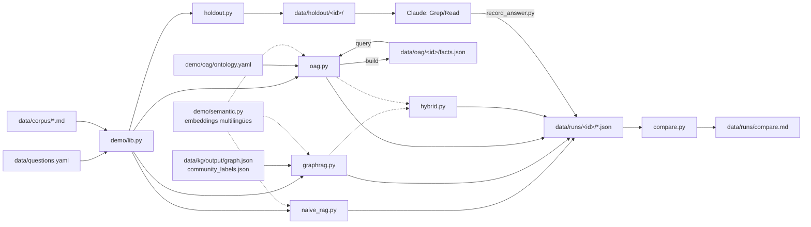

# Guía técnica de la demo: qué se ejecuta y dónde está

> English version: [TECHNICAL_GUIDE.md](TECHNICAL_GUIDE.md). Guía para presentar la demo:
> [GUIA_DEMO.md](GUIA_DEMO.md). Cómo ejecutarla en Claude Code: [EJECUTAR_DEMO.md](EJECUTAR_DEMO.md).
> Referencia rápida de uso: [`demo/README.md`](../demo/README.md).

Esta guía explica, paso a paso, qué ejecuta cada skill de la demo, en qué fichero y función está cada paso,
qué lee y qué escribe. Está pensada para quien quiera modificar la demo, reproducirla en otro repo o llevar
alguna pieza a `/kg` y `/kg-refresh`. Los enlaces a código apuntan a la línea donde empieza cada función en
la versión actual del repo.

## 1. Vista general



Las cuatro técnicas deterministas (Naive RAG, GraphRAG, OAG e híbrido) comparten el corpus y la pregunta;
Agentic RAG es el quinto enfoque y Claude busca y lee directamente. `compare.py` vuelve a lanzar las variantes
deterministas y reúne sus resultados con los de Claude en una tabla. Las técnicas deterministas no llaman a un
LLM durante la recuperación; Agentic RAG sí usa Claude para buscar y leer.

| Pieza | Fichero | Qué hace |
|---|---|---|
| Utilidades comunes | [`demo/lib.py`](../demo/lib.py) | Rutas, preguntas, corpus con hold-out, extracción de IDs, métricas, guardado de resultados |
| Naive RAG | [`demo/naive_rag.py`](../demo/naive_rag.py) | Trozos de texto, TF-IDF (o embeddings multilingües) y top-k |
| GraphRAG | [`demo/graphrag.py`](../demo/graphrag.py) | La consulta de `/kg` sobre `graph.json`: vecinos, lista de lectura y temas |
| OAG | [`demo/oag.py`](../demo/oag.py) | `build`: hechos tipados validados contra la ontología. `query`: set cover de fact blocks |
| Híbrido | [`demo/hybrid.py`](../demo/hybrid.py) | GraphRAG propone y la ontología filtra si la pregunta cae en ella; si no, propone qué modelar |
| Ontología | [`demo/oag/ontology.yaml`](../demo/oag/ontology.yaml) | Clases, relaciones, restricciones, componentes con sinónimos y reglas de extracción |
| Agentic RAG | [`.claude/skills/demo-agentic-rag/SKILL.md`](../.claude/skills/demo-agentic-rag/SKILL.md) | Claude busca y lee con Grep/Read; registra su respuesta |
| Vista de hold-out | [`demo/holdout.py`](../demo/holdout.py) | Escribe el corpus filtrado que lee Agentic RAG y un informe de exclusiones |
| Capa semántica | [`demo/semantic.py`](../demo/semantic.py) | Embeddings multilingües con caché; Naive RAG, GraphRAG y OAG los usan con `--embed` o `--semantic`, y el híbrido transmite esta opción a GraphRAG y OAG |
| Registro de respuestas | [`demo/record_answer.py`](../demo/record_answer.py) | Guarda los IDs que Claude da como respuesta final |
| Comparativa | [`demo/compare.py`](../demo/compare.py) | Relanza las técnicas deterministas y genera las tablas |
| Skills | [`.claude/skills/demo-*`](../.claude/skills/) | Guion de cada paso para Claude Code |

## 2. Entorno y datos

**Entorno.** [`pyproject.toml`](../pyproject.toml) define el proyecto para uv: `pyyaml` para la demo, el grupo
`deck` (python-pptx, pillow, cairosvg) por defecto y el grupo opcional `embed` (sentence-transformers y torch en
versión CPU, que se instala desde el índice de PyTorch para no traer CUDA). Sin uv basta con
[`demo/requirements.txt`](../demo/requirements.txt).

```bash
uv sync --group embed                    # con la capa semántica (apartado 8); uv sync a secas la deja fuera
source .venv/bin/activate                # activar antes de lanzar claude: las skills llaman a `python`
```

**Datos.** Todo lo real vive en `data/`, que está en [`.gitignore`](../.gitignore). Las rutas se definen en
[`lib.py`, líneas 23-30](../demo/lib.py#L23).

| Ruta | Origen | Lo usa |
|---|---|---|
| `data/corpus/*.md` | `_corpus/` de `/kg` en el repo lambda (453 ficheros; 450 en la pregunta A tras el hold-out) | Técnicas basadas en corpus; GraphRAG y el híbrido consultan el grafo filtrado con la misma vista |
| `data/kg/output/graph.json` | `output/graph.json` de `/kg-refresh` | `graphrag.py` |
| `data/kg/output/community_labels.json` | `community_labels.json` de `/kg-refresh` | `graphrag.py` (temas) |
| `data/kg/kg_query.sh` | wrapper de `/kg` | `graphrag.py --native` |
| `data/questions.yaml` | escrito a mano (plantilla: [`demo/questions.example.yaml`](../demo/questions.example.yaml)) | Todos |
| `data/oag/<id>/facts.json` | `oag.py build` | `oag.py query` |
| `data/runs/<id>/*.json`, `data/runs/compare.md` | cada técnica y `compare.py` | `compare.py` |
| `data/cache/embeddings/` | `semantic.py` (se regenera solo) | La capa semántica |

## 3. Las preguntas y el hold-out

`data/questions.yaml` contiene una lista `questions:` y un `default`. Cada pregunta tiene:

| Campo | Para qué |
|---|---|
| `id` | Nombre de la pregunta; se pasa con `--q <id>` y nombra las carpetas de `data/oag/` y `data/runs/` |
| `scenario` | Qué tipo de pregunta es (reglas o exploración) |
| `pregunta` | El texto que lee Claude |
| `pregunta_llana` | La misma pregunta en castellano llano, sin nombres de código; la usan los scripts con `--lang es` |
| `tema` | Tema en castellano para GraphRAG con `--lang es` |
| `hops` | Saltos por defecto de GraphRAG para esa pregunta (2 en la de exploración) |
| `query` | Texto de búsqueda en inglés para Naive RAG y OAG (el corpus está en inglés) |
| `topic` | Semilla de OAG y, si no hay `graph_topic`, de GraphRAG |
| `graph_topic` | Semilla de GraphRAG cuando el nombre del nodo difiere del tema |
| `holdout`, `holdout_files` | Tickets y ficheros que son la hoja de respuestas; se excluyen de todo |
| `esperado` | IDs de la respuesta esperada |
| `esperado_regla` | Cómo se obtuvo la respuesta esperada, si sale de una regla |

Funciones implicadas:

- [`add_question_arg`](../demo/lib.py#L45) añade `--q` a cada script (también se puede usar la variable de
  entorno `DEMO_Q`).
- [`list_questions`](../demo/lib.py#L76) y [`load_question`](../demo/lib.py#L103) leen el fichero. Aceptan el
  formato antiguo de una sola pregunta.
- [`add_lang_arg`](../demo/lib.py#L51) añade `--lang en|es`; [`spanish_question`](../demo/lib.py#L57) y
  [`spanish_topic`](../demo/lib.py#L62) devuelven `pregunta_llana` y `tema`, y
  [`run_key`](../demo/lib.py#L67) nombra el resultado según la variante (`naive_rag_es_sem`, `oag_v3_es`...).
- [`holdout_view`](../demo/lib.py#L219) es el corpus que ven todas las técnicas: quita `holdout_files`, las
  notas cuyo título o `tickets:` nombran el ticket reservado ([`derived_file`](../demo/lib.py#L142)) y, en el
  resto, cada sección, fila de tabla, viñeta o párrafo que lo menciona ([`redact`](../demo/lib.py#L158)).
  Devuelve también un informe de lo quitado. [`load_corpus`](../demo/lib.py#L262) la usa, y
  `python demo/holdout.py --q <id>` la escribe en `data/holdout/<id>/` para Agentic RAG.
- [`ticket_ids`](../demo/lib.py#L267) extrae IDs con [`TICKET_RE`](../demo/lib.py#L33) y quita los del
  `holdout`. Así ninguna técnica puede «acertar» citando la hoja de respuestas.

Las dos preguntas actuales y por qué se eligieron están en la
[guía de la demo, sección 5](GUIA_DEMO.md#las-dos-preguntas).

## 4. Naive RAG

**Skill:** [`/demo-naive-rag`](../.claude/skills/demo-naive-rag/SKILL.md). **Script:**
[`demo/naive_rag.py`](../demo/naive_rag.py).

```bash
python demo/naive_rag.py [--q <id>] [--k 5] [--chunk-words 180] [--overlap 30] [--embed] [--lang es]
```

1. Carga el corpus sin el hold-out ([`main`](../demo/naive_rag.py#L84)).
2. Parte cada documento en trozos de 180 palabras con 30 de solape
   ([`chunk`](../demo/naive_rag.py#L33)).
3. Ordena los trozos por similitud con `query` (o con `pregunta_llana` si `--lang es`,
   [línea 100](../demo/naive_rag.py#L100)): TF-IDF en Python puro, determinista y sin red
   ([`tfidf_rank`](../demo/naive_rag.py#L53)), o embeddings multilingües con `--embed`
   ([`embed_rank`](../demo/naive_rag.py#L78), apartado 8).
4. Se queda con los `k` mejores ([línea 104](../demo/naive_rag.py#L104)) y los imprime con su fichero y posición.
5. Devuelto = los IDs de ticket que aparecen en esos trozos ([línea 108](../demo/naive_rag.py#L108)).

Salida: `data/runs/<id>/naive_rag.json` (o `naive_rag_sem`, `naive_rag_es`, `naive_rag_es_sem`). Lo que enseña: la unidad de recuperación es un trozo de texto, sin
noción de ticket, componente ni relación.

## 5. Agentic RAG

**Skill:** [`/demo-agentic-rag`](../.claude/skills/demo-agentic-rag/SKILL.md). No hay script de recuperación:
Claude genera primero la vista sin hoja de respuestas (`python demo/holdout.py`) y después planifica, busca
con Grep y lee con Read solo en `data/holdout/<id>/`, con un máximo de 12 llamadas y sin acceso a `data/kg/`,
`data/oag/` ni `data/runs/`. Al final registra su respuesta:

```bash
python demo/record_answer.py [--q <id>] agentic_rag "<ids>" --tool-calls <n> --tokens <aprox>
```

[`record_answer.py`](../demo/record_answer.py#L20) guarda los IDs como resultado de recuperación y como
respuesta. Es la única técnica cuyo resultado cambia entre ejecuciones.

`holdout.py [--q <id>]` reutiliza `lib.holdout_view`, escribe los documentos filtrados en
`data/holdout/<id>/` y deja allí `_holdout_report.json` con los ficheros y pasajes excluidos. Regenera
esa carpeta de salida para la pregunta elegida; no modifica el corpus fuente.

## 6. GraphRAG (nuestro `/kg`)

**Skill:** [`/demo-graphrag`](../.claude/skills/demo-graphrag/SKILL.md). **Script:**
[`demo/graphrag.py`](../demo/graphrag.py).

```bash
python demo/graphrag.py [--q <id>] [--topic <tema>] [--hops <n>] [--lang es] [--semantic] [--full] [--native]
```

Es la misma consulta que hace `/kg` (`kg_query.sh <tema>`, equivalente a `graphify explain`), reimplementada
en Python para aplicar el hold-out y limitarla al corpus de la demo.

1. Carga `graph.json` y quita los nodos del hold-out y los que no vienen del corpus de la demo
   ([`load_graph`](../demo/graphrag.py#L35)). Del hold-out sale todo nodo cuyo fichero fuente esté excluido,
   cuyo id o etiqueta nombre el ticket reservado o una nota excluida, y los que se quedan sin ningún vecino
   al quitar los anteriores. `--full` usa el grafo entero.
2. Resuelve el tema a un nodo semilla: coincidencia exacta de id o etiqueta y, si no, por subcadena; en caso
   de empate, el nodo con más aristas ([`resolve`](../demo/graphrag.py#L94)). Con `--semantic`, el nodo cuya
   etiqueta más se parece al tema ([`resolve_semantic`](../demo/graphrag.py#L111), apartado 8). Si no hay
   semilla, guarda un resultado vacío en lugar de fallar ([línea 159](../demo/graphrag.py#L159)).
3. Recorre los vecinos por anchura hasta `--hops` saltos ([línea 176](../demo/graphrag.py#L176)), guardando
   relación y confianza de cada arista.
4. Construye el contexto (semilla y vecinos con su fichero de origen) y la lista de lectura
   ([líneas 192-193](../demo/graphrag.py#L192)).
5. Agrupa los vecinos en temas con los nombres de comunidad de `community_labels.json`
   ([`community_names`](../demo/graphrag.py#L80), [línea 196](../demo/graphrag.py#L196)). Es lo que responde
   «en qué temas se agrupan» en la pregunta de exploración.
6. Imprime el reparto de relaciones y cuántas son genéricas (`references`, `relates_to`...).
7. Devuelto = los IDs de ticket del contexto.

Salida: `data/runs/<id>/graphrag.json` (1 salto) o `graphrag_2h.json` (2 saltos), con los sufijos `_es` y
`_sem` según la variante. `--native` llama a
`data/kg/kg_query.sh` y no puntúa.

## 7. OAG

**Skill:** [`/demo-oag`](../.claude/skills/demo-oag/SKILL.md). **Script:** [`demo/oag.py`](../demo/oag.py).
**Ontología:** [`demo/oag/ontology.yaml`](../demo/oag/ontology.yaml).

```bash
python demo/oag.py build [--q <id>]              # corpus -> hechos validados
python demo/oag.py query [--q <id>] [--schema 1|2|3] [--lang es] [--semantic] [--min-sim 0.42]
```

### 7.1 La ontología

| Sección | Contenido |
|---|---|
| `classes` | `Ticket`, `Invariant`, `Component`, `Test`, con patrón de id y campos obligatorios |
| `relations` | `touches`, `guards`, `originates`, `verified_by`, `must_not_break` y, desde la v2, `calls` |
| `constraints` | `must_not_break_same_component` (v2): un ticket «no romper» debe compartir componente con la pregunta |
| `labels` | `alt_labels_es` (v3): los sinónimos en castellano solo se comparan con la pregunta, no con el corpus |
| `components` | `letter_end_detection`, `title_detection`, `numbering`, `letter_start`, con sus sinónimos (`alt_labels`), en la v2 `calls` y en la v3 `alt_labels_es` |
| `extraction` | Umbral de menciones para `touches` y frases que marcan `must_not_break` |

El campo `since` marca qué versión del esquema añadió cada relación o restricción. `--schema 1` las ignora y
reproduce la primera ontología. La explicación divulgativa de v1 y v2 está en la
[guía de la demo](GUIA_DEMO.md#de-oag-v1-a-v2-el-esquema-también-se-depura).

### 7.2 `build`: del corpus a hechos validados

[`build`](../demo/oag.py#L121) recorre el corpus y propone aristas candidatas; después las valida.

1. **Componentes** de la ontología como nodos, y las aristas `calls` declaradas en ella
   ([línea 161](../demo/oag.py#L161)).
2. **Writeups de ticket** (`sst-NNNN__*.md`): el ticket es un nodo; `touches` si el texto nombra un componente
   al menos 3 veces ([`components_in`](../demo/oag.py#L55)); cada otro ticket citado en una línea genera
   `must_not_break` si la línea contiene una frase de aviso, o `mentions` si no
   ([líneas 167-178](../demo/oag.py#L167)).
3. **`SHARP_EDGES`**: cada fila del índice de invariantes y cada viñeta `- **TKT-NNN ...**` es un `Invariant`,
   con `originates` desde su ticket de origen y `guards` hacia los componentes que nombra
   ([`parse_invariants`](../demo/oag.py#L98), [línea 179](../demo/oag.py#L179)).
4. **Tests**: cada `tests/test_tkt_NNN_*.py` citado da `verified_by` desde su ticket
   ([línea 189](../demo/oag.py#L189)).
5. **Validación** al estilo de SHACL, el estándar del W3C para validar grafos contra un esquema (definición en
   la [guía de la demo](GUIA_DEMO.md#2-conceptos-principales)) ([línea 199](../demo/oag.py#L199)): se rechaza toda arista cuya relación no
   esté en la ontología (las `mentions`), o cuyo dominio o rango no sea el declarado, o que no tenga fuente. Se
   avisa de los nodos cuyo id no cumple el patrón o a los que les falta un campo obligatorio.
6. Escribe `data/oag/<id>/facts.json` con nodos, aristas aceptadas y un informe (aceptadas y rechazadas por
   motivo). Cero llamadas LLM.

### 7.3 `query`: de la pregunta a fact blocks

[`query`](../demo/oag.py#L239):

1. Mapea la pregunta (`topic` + `query`, o `pregunta_llana` con `--lang es`) a componentes de la ontología
   por sus sinónimos ([`components_in`](../demo/oag.py#L55); desde la v3 también los de `alt_labels_es`). Con
   `--semantic` los elige por similitud ([`components_semantic`](../demo/oag.py#L78), apartado 8). Si no
   encuentra ninguno, no hay hechos que dar: es lo que pasa en la pregunta de exploración.
2. Relevantes = invariantes que vigilan esos componentes (`guards`).
3. **v2, `calls`**: sigue la dependencia hasta el componente llamado y añade solo los invariantes que nombran el
   símbolo llamado (`get_titles`), anotando `reached_via` ([líneas 280-288](../demo/oag.py#L280)).
4. Tickets que los writeups del componente piden no romper (`must_not_break`). **v2, restricción:** solo cuentan
   si tocan el componente u originan un invariante que lo vigila ([líneas 290-297](../demo/oag.py#L290)).
5. **Set cover voraz**, como en OG-RAG: cada ticket es un bloque que cubre a sí mismo y a sus invariantes; se
   eligen bloques hasta cubrir todo lo relevante ([líneas 300-315](../demo/oag.py#L300)).
6. Cada fact block lleva el ticket, sus invariantes (texto, origen, componentes, `reached_via`), quién lo nombra
   como «no romper», sus tests y la fuente ([línea 318](../demo/oag.py#L318)).
7. Devuelto = sujeto de cada bloque + orígenes de sus invariantes. Los tickets que solo figuran como procedencia
   (`named_as_must_not_break_by`) no cuentan ([línea 391](../demo/oag.py#L391)).

Salida: `data/runs/<id>/oag.json` (v2), `oag_v1.json` u `oag_v3.json`, con los sufijos `_es` y `_sem` según la
variante.

### 7.4 El híbrido: GraphRAG propone, la ontología filtra

[`demo/hybrid.py`](../demo/hybrid.py) ([`main`](../demo/hybrid.py#L64)) no recupera nada por su cuenta: combina
las dos técnicas anteriores, sin LLM.

1. Lanza `graphrag.py` a 2 saltos y `oag.py query` con los mismos flags (`--q`, `--lang`, `--semantic`) y lee sus
   resultados de `data/runs/<id>/` ([líneas 83-84](../demo/hybrid.py#L83)). Así las cifras son exactamente las
   de cada técnica.
2. Si la pregunta se asocia a algún componente de la ontología ([línea 97](../demo/hybrid.py#L97)), filtra los
   candidatos del grafo en dos pasos: primero los que la ontología conecta con el componente, por clases y
   relaciones ([`linked_to`](../demo/hybrid.py#L45)), y después los que cumplen sus reglas, que son los que
   devuelve la consulta de OAG v2 ([líneas 99-101](../demo/hybrid.py#L99)). Informa de los tickets que OAG
   encuentra y el grafo no propuso.
3. Si no se asocia a ninguno ([línea 116](../demo/hybrid.py#L116)), la respuesta es la lista de GraphRAG sin
   tocar, y las comunidades del vecindario se imprimen como propuesta para ampliar la ontología. La propuesta
   no se aplica: la revisa una persona.

Resultado en las dos preguntas: en A, 53 candidatos, 22 conectados al componente y 15 que cumplen las reglas
(100 % / 47 %, igual que OAG v2; el grafo no aporta ningún ticket que OAG no tuviera). En B, la lista de GraphRAG
(83 % / 43 %). El híbrido iguala a la mejor técnica en cada pregunta sin tener que elegirla; su punto débil es
decidir si la pregunta cae en la ontología.

Salida: `data/runs/<id>/hybrid.json`, con `route` (`ontology` o `graphrag`), `candidates` y `proposal`.

## 8. La capa semántica (pregunta en castellano)

El corpus está en inglés y las técnicas base (Naive RAG, GraphRAG y OAG) comparan palabras. Con `--lang es`
reciben la pregunta en castellano llano y, sin más, no encuentran nada. El híbrido hereda las opciones
semánticas de GraphRAG y OAG. La capa semántica es un modelo de embeddings multilingüe que cada técnica
usa solo en su primer paso de selección: chunks en Naive RAG, semilla en GraphRAG y componentes en OAG.
Resultados e interpretación en la
[guía de la demo](GUIA_DEMO.md#la-misma-pregunta-en-castellano-llano-la-capa-semántica).

**El módulo** ([`demo/semantic.py`](../demo/semantic.py)):

- Modelo por defecto `paraphrase-multilingual-MiniLM-L12-v2` ([línea 27](../demo/semantic.py#L27)): más de 50
  idiomas, vectores de 384 dimensiones, unos 470 MB, en CPU. Se cambia con `--model` o `DEMO_EMBED_MODEL`.
- [`encode`](../demo/semantic.py#L49) devuelve vectores normalizados y los guarda en `data/cache/embeddings/`
  con una clave que depende del texto y del modelo, así que el corpus y las etiquetas del grafo solo se
  calculan una vez.
- [`similarities`](../demo/semantic.py#L74) y [`rank`](../demo/semantic.py#L80) dan el coseno de la pregunta
  con cada texto.
- Se importa solo cuando se pide (`--embed`, `--semantic`): sin el grupo `embed` el resto de la demo funciona
  igual.

**Dónde entra en cada técnica:**

| Técnica | Opción | Qué compara | Código |
|---|---|---|---|
| Naive RAG | `--embed` | La pregunta con cada trozo de 180 palabras | [`embed_rank`](../demo/naive_rag.py#L78) |
| GraphRAG | `--semantic` | El tema con la etiqueta de cada nodo (3.977); semilla = el más parecido, e imprime los cinco primeros | [`resolve_semantic`](../demo/graphrag.py#L111) |
| OAG | `--semantic` | Cada cláusula de la pregunta con la descripción de cada componente (`label` y `alt_labels` en inglés); entran los que superan `--min-sim` | [`components_semantic`](../demo/oag.py#L78), [línea 384](../demo/oag.py#L384) |
| Híbrido | `--semantic` | Pasa la opción a GraphRAG y OAG; no añade otra comparación semántica | [`main`](../demo/hybrid.py#L52) |
| OAG | `--schema 3` | Sin modelo: los sinónimos en castellano de la ontología, por coincidencia de texto | [`components_in`](../demo/oag.py#L55), [`labels`](../demo/oag/ontology.yaml#L43) |

En OAG la pregunta se parte en cláusulas porque una pregunta larga diluye cualquier concepto. El umbral por
defecto (0,42) se calibró con las dos preguntas de la demo; con más preguntas hay que fijarlo con preguntas
no vistas. Una vez elegidos los componentes, el resto de `query` no cambia: el idioma solo afecta al primer
paso.

**Red.** La primera ejecución descarga el modelo de huggingface.co y su CDN (`*.hf.co`); torch CPU sale de
download.pytorch.org (y download-r2.pytorch.org). Después se puede trabajar sin red con `HF_HUB_OFFLINE=1`.

## 9. Métricas y comparativa

**Puntuación** ([`score`](../demo/lib.py#L281)): recall = esperados encontrados / esperados; precisión =
esperados encontrados / devueltos. F1 se calcula en [`compare.py`](../demo/compare.py#L78). Tokens de contexto =
caracteres / 4 ([`approx_tokens`](../demo/lib.py#L301)).

**Qué cuenta como devuelto** depende de lo que cada técnica afirma: los IDs de los trozos (Naive RAG), los del
contexto del grafo (GraphRAG), los sujetos y orígenes de los fact blocks (OAG) y los que Claude da como respuesta
(Agentic RAG). El criterio y sus límites están en la [guía de la demo, sección 6](GUIA_DEMO.md#6-cómo-evaluamos).

**`compare.py`** ([`main`](../demo/compare.py#L106)), para cada pregunta o solo `--q`:

1. Relanza Naive RAG, GraphRAG a 1 y 2 saltos, OAG v1 y v2 y el híbrido ([líneas 118-126](../demo/compare.py#L118)); si no hay
   hechos, ejecuta antes `oag.py build`. Después, las variantes en castellano llano sin modelo y, si está
   instalado el grupo `embed` ([`has_embed`](../demo/compare.py#L58)), las semánticas
   ([líneas 127-136](../demo/compare.py#L127)).
2. Lee `data/runs/<id>/*.json`, incluidos Agentic RAG y las respuestas registradas de Claude
   ([`table`](../demo/compare.py#L84)).
3. Imprime dos tablas por pregunta, en inglés y en castellano llano ([`order_es`](../demo/compare.py#L42)), y
   las guarda en `data/runs/compare.md`.

`record_answer.py` añade a cada resultado la respuesta final de Claude (`answer`, `answer_score`), que aparece en
la última columna de la tabla.

## 10. Formato de los resultados

Cada `data/runs/<id>/<técnica>.json` tiene, como mínimo:

```json
{
  "technique": "OAG (esquema v2)",
  "found": ["TKT-101", "TKT-102"],
  "score": {"found": 2, "hits": ["TKT-101"], "missed": ["TKT-103"], "recall": 0.5, "precision": 0.5},
  "context_tokens": 2500,
  "llm_calls_retrieval": 0,
  "sources": ["hub__SHARP_EDGES.md"]
}
```

Todos añaden `lang`. GraphRAG añade `hops`, `topic`, `seed` y `themes`; OAG añade `schema`, `components` y, con
`--semantic`, `similarities`; con una respuesta registrada se añaden
`answer` y `answer_score`.

## 11. Cómo extenderla

**Añadir una pregunta.** Añadir una entrada a `data/questions.yaml` (ver la plantilla). Si es de reglas, escribir
la respuesta esperada a partir de un writeup y declararlo en `holdout`. Después:
`python demo/oag.py build --q <id>` y `python demo/compare.py --q <id>`.

**Añadir un componente a la ontología.** Añadir su entrada en `components:` con `label` y `alt_labels` (y `calls`
si llama a otro), reconstruir los hechos y comprobar en el informe de `build` qué aristas nuevas acepta. Es lo que
haría que OAG respondiera la pregunta de exploración.

**Añadir un idioma.** Escribir `pregunta_llana` y `tema` en ese idioma (o un campo nuevo y su opción en
[`add_lang_arg`](../demo/lib.py#L51)) y, para OAG sin modelo, sus sinónimos en la ontología. El modelo por
defecto ya es multilingüe.

**Cambiar la ontología sin romper la comparación.** Marcar lo nuevo con `since: <versión>` y ampliar `choices`
de `--schema` en [`oag.py`](../demo/oag.py#L346). Así la demo puede enseñar el antes y el después.

**Llevarlo a `/kg`.** El mapa de qué pieza va a cada fase (Paso 0 y Fases A a D) está en la
[guía de la demo, sección 8](GUIA_DEMO.md#8-lecciones-para-los-skills-de-la-metodología) y en
[`HANDOVER.md`](../HANDOVER.md#5-qué-adoptar-plan-accionable).

## 12. Problemas frecuentes

| Síntoma | Causa | Solución |
|---|---|---|
| `No question file at data/questions.yaml` | Falta el fichero de preguntas | Copiar `demo/questions.example.yaml` y rellenarlo |
| `No facts yet` | No se ha ejecutado `build` para esa pregunta | `python demo/oag.py build --q <id>` |
| `semilla: ninguna` en GraphRAG | El tema no se llama como ningún nodo (por ejemplo, en castellano) | Usar `--topic` o `graph_topic` con un nombre de nodo, o `--semantic` |
| `The semantic layer needs sentence-transformers` | Falta el grupo `embed` | `uv sync --group embed` |
| Error al descargar el modelo (403, `Cannot reach`) | La red no permite huggingface.co o `*.hf.co` | Permitir esos dominios, o copiar `~/.cache/huggingface` de otra máquina y usar `HF_HUB_OFFLINE=1` |
| Los resultados no cambian tras actualizar el corpus | Hechos antiguos | Volver a ejecutar `build` para cada pregunta |
| Caracteres raros en Windows | Consola cp1252 | Los scripts fuerzan UTF-8 ([`utf8_stdout`](../demo/lib.py#L36)); usar Windows Terminal o WSL |
| `python: command not found` en WSL | venv sin activar | `source .venv/bin/activate` antes de lanzar `claude` |
| Faltan temas en GraphRAG | No está `community_labels.json` | Copiarlo de `/kg-refresh` a `data/kg/output/` |
