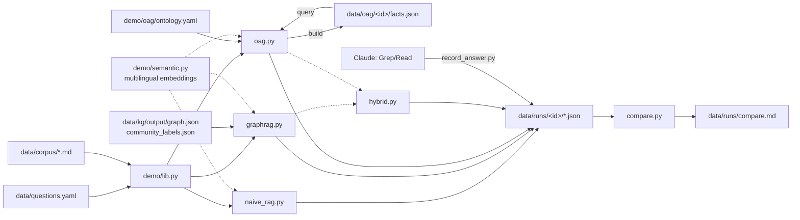

# Demo technical guide: what runs and where it lives

> Versión en castellano: [GUIA_TECNICA.md](GUIA_TECNICA.md). Guide to presenting the demo:
> [DEMO_GUIDE.md](DEMO_GUIDE.md). How to run it in Claude Code: [RUN_DEMO.md](RUN_DEMO.md).
> Quick usage reference: [`demo/README.md`](../demo/README.md).

This guide explains, step by step, what each demo skill runs, which file and function holds each step, and what
it reads and writes. It is meant for anyone who wants to change the demo, reproduce it in another repo or take a
piece of it to `/kg` and `/kg-refresh`. Code links point to the line where each function starts in the current
version of the repo.

## 1. Overview



Four techniques read the same corpus and the same question, and each leaves its result in the same format.
`compare.py` runs them again and puts them in a table. No technique calls an LLM to retrieve; the only LLM is
Claude, which in each skill reads what was retrieved and answers.

| Piece | File | What it does |
|---|---|---|
| Shared helpers | [`demo/lib.py`](../demo/lib.py) | Paths, questions, corpus with hold-out, ID extraction, metrics, saving results |
| Naive RAG | [`demo/naive_rag.py`](../demo/naive_rag.py) | Text chunks, TF-IDF (or multilingual embeddings) and top-k |
| GraphRAG | [`demo/graphrag.py`](../demo/graphrag.py) | The `/kg` query over `graph.json`: neighbours, reading list and themes |
| OAG | [`demo/oag.py`](../demo/oag.py) | `build`: typed facts validated against the ontology. `query`: set cover of fact blocks |
| Hybrid | [`demo/hybrid.py`](../demo/hybrid.py) | GraphRAG proposes and the ontology filters if the question falls inside it; otherwise it proposes what to model |
| Ontology | [`demo/oag/ontology.yaml`](../demo/oag/ontology.yaml) | Classes, relations, constraints, components with synonyms and extraction rules |
| Agentic RAG | [`.claude/skills/demo-agentic-rag/SKILL.md`](../.claude/skills/demo-agentic-rag/SKILL.md) | Claude searches and reads with Grep/Read; records its answer |
| Semantic layer | [`demo/semantic.py`](../demo/semantic.py) | Cached multilingual embeddings, used by the three deterministic techniques with `--embed` or `--semantic` |
| Answer recording | [`demo/record_answer.py`](../demo/record_answer.py) | Saves the IDs Claude gives as its final answer |
| Comparison | [`demo/compare.py`](../demo/compare.py) | Re-runs the deterministic techniques and builds the tables |
| Skills | [`.claude/skills/demo-*`](../.claude/skills/) | Script for each step, for Claude Code |

## 2. Environment and data

**Environment.** [`pyproject.toml`](../pyproject.toml) defines the uv project: `pyyaml` for the demo, the `deck`
group (python-pptx, pillow, cairosvg) by default and the optional `embed` group (sentence-transformers and CPU
torch, installed from the PyTorch index so that it does not pull CUDA). Without uv,
[`demo/requirements.txt`](../demo/requirements.txt) is enough.

```bash
uv sync --group embed                    # with the semantic layer (section 8); a plain uv sync leaves it out
source .venv/bin/activate                # activate before starting claude: the skills call `python`
```

**Data.** Everything real lives in `data/`, which is in [`.gitignore`](../.gitignore). The paths are defined in
[`lib.py`, lines 15-22](../demo/lib.py#L15).

| Path | Origin | Used by |
|---|---|---|
| `data/corpus/*.md` | `/kg`'s `_corpus/` in the lambda repo (452 files after the hold-out) | All four techniques |
| `data/kg/output/graph.json` | `output/graph.json` from `/kg-refresh` | `graphrag.py` |
| `data/kg/output/community_labels.json` | `community_labels.json` from `/kg-refresh` | `graphrag.py` (themes) |
| `data/kg/kg_query.sh` | `/kg` wrapper | `graphrag.py --native` |
| `data/questions.yaml` | hand-written (template: [`demo/questions.example.yaml`](../demo/questions.example.yaml)) | All |
| `data/oag/<id>/facts.json` | `oag.py build` | `oag.py query` |
| `data/runs/<id>/*.json`, `data/runs/compare.md` | each technique and `compare.py` | `compare.py` |
| `data/cache/embeddings/` | `semantic.py` (rebuilt automatically) | The semantic layer |

## 3. Questions and hold-out

`data/questions.yaml` holds a `questions:` list and a `default`. Each question has:

| Field | Purpose |
|---|---|
| `id` | Question name; passed with `--q <id>` and names the folders under `data/oag/` and `data/runs/` |
| `scenario` | What kind of question it is (rules or exploration) |
| `pregunta` | The text Claude reads |
| `pregunta_llana` | The same question in plain Spanish, with no code names; the scripts use it with `--lang es` |
| `tema` | Spanish topic for GraphRAG with `--lang es` |
| `hops` | Default GraphRAG hops for that question (2 for the exploration one) |
| `query` | English search text for Naive RAG and OAG (the corpus is in English) |
| `topic` | OAG seed and, without `graph_topic`, GraphRAG seed |
| `graph_topic` | GraphRAG seed when the node name differs from the topic |
| `holdout`, `holdout_files` | Tickets and files that are the answer key; excluded from everything |
| `esperado` | IDs of the expected answer |
| `esperado_regla` | How the expected answer was obtained, when it comes from a rule |

Functions involved:

- [`add_question_arg`](../demo/lib.py#L36) adds `--q` to every script (the `DEMO_Q` environment variable works
  too).
- [`list_questions`](../demo/lib.py#L60) and [`load_question`](../demo/lib.py#L79) read the file. They accept
  the older single-question format.
- [`add_lang_arg`](../demo/lib.py#L41) adds `--lang en|es`; [`spanish_question`](../demo/lib.py#L46) and
  [`spanish_topic`](../demo/lib.py#L51) return `pregunta_llana` and `tema`, and
  [`run_key`](../demo/lib.py#L55) names the result after the variant (`naive_rag_es_sem`, `oag_v3_es`...).
- [`load_corpus`](../demo/lib.py#L102) loads `data/corpus/*.md` skipping `holdout_files`.
- [`ticket_ids`](../demo/lib.py#L115) extracts IDs with [`TICKET_RE`](../demo/lib.py#L24) and drops the
  `holdout` ones, so no technique can "score" by quoting the answer key.

The two current questions and why they were chosen are in the
[demo guide, section 5](DEMO_GUIDE.md#the-two-questions).

## 4. Naive RAG

**Skill:** [`/demo-naive-rag`](../.claude/skills/demo-naive-rag/SKILL.md). **Script:**
[`demo/naive_rag.py`](../demo/naive_rag.py).

```bash
python demo/naive_rag.py [--q <id>] [--k 5] [--chunk-words 180] [--overlap 30] [--embed] [--lang es]
```

1. Loads the corpus without the hold-out ([`main`](../demo/naive_rag.py#L67)).
2. Splits each document into 180-word chunks with a 30-word overlap ([`chunk`](../demo/naive_rag.py#L31)).
3. Ranks the chunks by similarity to `query` (or to `pregunta_llana` with `--lang es`,
   [line 82](../demo/naive_rag.py#L82)): pure-Python TF-IDF, deterministic and offline
   ([`tfidf_rank`](../demo/naive_rag.py#L43)), or multilingual embeddings with `--embed`
   ([`embed_rank`](../demo/naive_rag.py#L62), section 8).
4. Keeps the top `k` ([line 85](../demo/naive_rag.py#L85)) and prints them with their file and position.
5. Returned = the ticket IDs that appear in those chunks ([line 88](../demo/naive_rag.py#L88)).

Output: `data/runs/<id>/naive_rag.json` (or `naive_rag_sem`, `naive_rag_es`, `naive_rag_es_sem`). What it shows: the retrieval unit is a text chunk, with no notion of
ticket, component or relation.

## 5. Agentic RAG

**Skill:** [`/demo-agentic-rag`](../.claude/skills/demo-agentic-rag/SKILL.md). There is no retrieval script:
Claude plans, searches with Grep and reads with Read, with at most 12 calls and no access to `data/kg/`,
`data/oag/`, `data/runs/` or the hold-out files. At the end it records its answer:

```bash
python demo/record_answer.py [--q <id>] agentic_rag "<ids>" --tool-calls <n> --tokens <approx>
```

[`record_answer.py`](../demo/record_answer.py#L20) stores the IDs as both the retrieval result and the answer. It
is the only technique whose result changes between runs.

## 6. GraphRAG (our `/kg`)

**Skill:** [`/demo-graphrag`](../.claude/skills/demo-graphrag/SKILL.md). **Script:**
[`demo/graphrag.py`](../demo/graphrag.py).

```bash
python demo/graphrag.py [--q <id>] [--topic <topic>] [--hops 1|2] [--lang es] [--semantic] [--full] [--native]
```

It is the same query `/kg` runs (`kg_query.sh <topic>`, equivalent to `graphify explain`), reimplemented in
Python to apply the hold-out and restrict it to the demo corpus.

1. Loads `graph.json` and drops hold-out nodes and nodes that do not come from the demo corpus
   ([`load_graph`](../demo/graphrag.py#L35)). `--full` uses the whole graph.
2. Resolves the topic to a seed node: exact id or label match, otherwise substring; ties go to the node with
   most edges ([`resolve`](../demo/graphrag.py#L64)). With `--semantic`, the node whose label is closest to the
   topic ([`resolve_semantic`](../demo/graphrag.py#L76), section 8). With no seed it saves an empty result
   instead of failing ([line 118](../demo/graphrag.py#L118)).
3. Walks the neighbours breadth-first up to `--hops` hops ([line 133](../demo/graphrag.py#L133)), keeping each
   edge's relation and confidence.
4. Builds the context (seed and neighbours with their source file) and the reading list
   ([lines 148-149](../demo/graphrag.py#L148)).
5. Groups the neighbours into themes with the community names in `community_labels.json`
   ([`community_names`](../demo/graphrag.py#L54), [line 152](../demo/graphrag.py#L152)). That is what answers
   "how do they group into themes" in the exploration question.
6. Prints the relation mix and how many edges are generic (`references`, `relates_to`...).
7. Returned = the ticket IDs in the context.

Output: `data/runs/<id>/graphrag.json` (1 hop) or `graphrag_2h.json` (2 hops), with `_es` and `_sem` suffixes
for the variants. `--native` calls
`data/kg/kg_query.sh` and does not score.

## 7. OAG

**Skill:** [`/demo-oag`](../.claude/skills/demo-oag/SKILL.md). **Script:** [`demo/oag.py`](../demo/oag.py).
**Ontology:** [`demo/oag/ontology.yaml`](../demo/oag/ontology.yaml).

```bash
python demo/oag.py build [--q <id>]              # corpus -> validated facts
python demo/oag.py query [--q <id>] [--schema 1|2|3] [--lang es] [--semantic] [--min-sim 0.42]
```

### 7.1 The ontology

| Section | Content |
|---|---|
| `classes` | `Ticket`, `Invariant`, `Component`, `Test`, with id pattern and required fields |
| `relations` | `touches`, `guards`, `originates`, `verified_by`, `must_not_break` and, since v2, `calls` |
| `constraints` | `must_not_break_same_component` (v2): a "must not break" ticket must share a component with the question |
| `labels` | `alt_labels_es` (v3): Spanish synonyms are only matched against the question, not the corpus |
| `components` | `letter_end_detection`, `title_detection`, `numbering`, `letter_start`, with their synonyms (`alt_labels`), in v2 `calls` and in v3 `alt_labels_es` |
| `extraction` | Mention threshold for `touches` and phrases that mark `must_not_break` |

The `since` field marks which schema version added each relation or constraint. `--schema 1` ignores them and
reproduces the first ontology. The plain-language explanation of v1 and v2 is in the
[demo guide](DEMO_GUIDE.md#from-oag-v1-to-v2-the-schema-gets-debugged-too).

### 7.2 `build`: from the corpus to validated facts

[`build`](../demo/oag.py#L98) walks the corpus and proposes candidate edges, then validates them.

1. **Components** of the ontology as nodes, plus the `calls` edges it declares ([line 116](../demo/oag.py#L116)).
2. **Ticket writeups** (`sst-NNNN__*.md`): the ticket is a node; `touches` if the text names a component at
   least 3 times ([`components_in`](../demo/oag.py#L52)); every other ticket cited on a line yields
   `must_not_break` if the line contains a warning phrase, or `mentions` otherwise
   ([lines 122-133](../demo/oag.py#L122)).
3. **`SHARP_EDGES`**: each row of the invariant index and each `- **TKT-NNN ...**` bullet is an `Invariant`,
   with `originates` from its ticket of origin and `guards` towards the components it names
   ([`parse_invariants`](../demo/oag.py#L83), [line 134](../demo/oag.py#L134)).
4. **Tests**: each cited `tests/test_tkt_NNN_*.py` yields `verified_by` from its ticket
   ([line 144](../demo/oag.py#L144)).
5. **SHACL-style validation**, after the W3C standard for validating graphs against a schema (defined in the
   [demo guide](DEMO_GUIDE.md#2-key-concepts)) ([line 154](../demo/oag.py#L154)): any edge whose relation is not in the ontology
   (the `mentions`), whose domain or range is not the declared one, or that has no source, is rejected. Nodes
   whose id does not match the pattern or that miss a required field are reported.
6. Writes `data/oag/<id>/facts.json` with nodes, accepted edges and a report (accepted and rejected by reason).
   Zero LLM calls.

### 7.3 `query`: from the question to fact blocks

[`query`](../demo/oag.py#L193):

1. Maps the question (`topic` + `query`, or `pregunta_llana` with `--lang es`) to ontology components through
   their synonyms ([`components_in`](../demo/oag.py#L52); from v3 also those in `alt_labels_es`). With
   `--semantic` it picks them by similarity ([`components_semantic`](../demo/oag.py#L63), section 8). If none
   matches, there are no facts to give: that is what happens in the exploration question.
2. Relevant = invariants that guard those components (`guards`).
3. **v2, `calls`**: follows the dependency to the called component and adds only the invariants that name the
   called symbol (`get_titles`), noting `reached_via` ([lines 207-215](../demo/oag.py#L207)).
4. Tickets that the component's writeups ask not to break (`must_not_break`). **v2, constraint:** they only
   count if they touch the component or originate an invariant that guards it
   ([lines 217-223](../demo/oag.py#L217)).
5. **Greedy set cover**, as in OG-RAG: each ticket is a block covering itself and its invariants; blocks are
   picked until everything relevant is covered ([lines 226-240](../demo/oag.py#L226)).
6. Each fact block carries the ticket, its invariants (text, origin, components, `reached_via`), who names it as
   "must not break", its tests and its source ([line 242](../demo/oag.py#L242)).
7. Returned = subject of each block + origins of its invariants. Tickets that only appear as provenance
   (`named_as_must_not_break_by`) do not count ([line 314](../demo/oag.py#L314)).

Output: `data/runs/<id>/oag.json` (v2), `oag_v1.json` or `oag_v3.json`, with `_es` and `_sem` suffixes for the
variants.

### 7.4 The hybrid: GraphRAG proposes, the ontology filters

[`demo/hybrid.py`](../demo/hybrid.py) ([`main`](../demo/hybrid.py#L55)) retrieves nothing on its own: it combines
the two previous techniques, with no LLM.

1. Runs `graphrag.py` at 2 hops and `oag.py query` with the same flags (`--q`, `--lang`, `--semantic`) and reads
   their results from `data/runs/<id>/` ([lines 72-73](../demo/hybrid.py#L72)), so the figures are exactly those
   of each technique.
2. If the question maps to an ontology component ([line 85](../demo/hybrid.py#L85)), it filters the graph's
   candidates in two steps: first those the ontology connects to the component through classes and relations
   ([`linked_to`](../demo/hybrid.py#L43)), then those that meet its rules, which are the ones the OAG v2 query
   returns ([lines 87-89](../demo/hybrid.py#L87)). It reports any ticket OAG finds that the graph did not propose.
3. If it maps to none ([line 104](../demo/hybrid.py#L104)), the answer is GraphRAG's list as it is, and the
   neighbourhood's communities are printed as a proposal to extend the ontology. The proposal is not applied: a
   person reviews it.

Result on the two questions: on A, 53 candidates, 22 connected to the component and 15 that meet the rules
(100% / 47%, the same as OAG v2; the graph adds no ticket OAG did not already have). On B, GraphRAG's list
(83% / 43%). The hybrid matches the best technique on each question without having to choose it; its weak point
is deciding whether the question falls inside the ontology.

Output: `data/runs/<id>/hybrid.json`, with `route` (`ontology` or `graphrag`), `candidates` and `proposal`.

## 8. The semantic layer (question in Spanish)

The corpus is in English and the three deterministic techniques compare words. With `--lang es` they get the
question in plain Spanish and, on their own, find nothing. The semantic layer is a multilingual embedding model
that each technique uses only at the step where it compares the question with the corpus. Results and how to
read them are in the [demo guide](DEMO_GUIDE.md#the-same-question-in-plain-spanish-the-semantic-layer).

**The module** ([`demo/semantic.py`](../demo/semantic.py)):

- Default model `paraphrase-multilingual-MiniLM-L12-v2` ([line 27](../demo/semantic.py#L27)): over 50
  languages, 384-dimensional vectors, about 470 MB, on CPU. Change it with `--model` or `DEMO_EMBED_MODEL`.
- [`encode`](../demo/semantic.py#L47) returns normalised vectors and stores them in `data/cache/embeddings/`
  under a key that depends on the text and the model, so the corpus and the graph labels are computed once.
- [`similarities`](../demo/semantic.py#L63) and [`rank`](../demo/semantic.py#L69) give the cosine of the
  question with each text.
- It is imported only when asked for (`--embed`, `--semantic`): without the `embed` group the rest of the demo
  works the same.

**Where it enters each technique:**

| Technique | Option | What it compares | Code |
|---|---|---|---|
| Naive RAG | `--embed` | The question with each 180-word chunk | [`embed_rank`](../demo/naive_rag.py#L62) |
| GraphRAG | `--semantic` | The topic with every node label (3,977); seed = the closest, and it prints the top five | [`resolve_semantic`](../demo/graphrag.py#L76) |
| OAG | `--semantic` | Each clause of the question with each component's description (`label` and English `alt_labels`); those above `--min-sim` are kept | [`components_semantic`](../demo/oag.py#L63), [line 307](../demo/oag.py#L307) |
| OAG | `--schema 3` | No model: the ontology's Spanish synonyms, by text match | [`components_in`](../demo/oag.py#L52), [`labels`](../demo/oag/ontology.yaml#L43) |

In OAG the question is split into clauses because a long question dilutes any single concept. The default
threshold (0.42) was calibrated on the two demo questions; with more questions it should be set on unseen ones.
Once the components are chosen, the rest of `query` does not change: the language only affects the first step.

**Network.** The first run downloads the model from huggingface.co and its CDN (`*.hf.co`); CPU torch comes from
download.pytorch.org (and download-r2.pytorch.org). After that it can run offline with `HF_HUB_OFFLINE=1`.

## 9. Metrics and comparison

**Scoring** ([`score`](../demo/lib.py#L126)): recall = expected found / expected; precision = expected found /
returned. F1 is computed in [`compare.py`](../demo/compare.py#L70). Context tokens = characters / 4
([`approx_tokens`](../demo/lib.py#L138)).

**What counts as returned** depends on what each technique asserts: the IDs in the chunks (Naive RAG), those in
the graph context (GraphRAG), the subjects and origins of the fact blocks (OAG) and those Claude gives as its
answer (Agentic RAG). The criterion and its limits are in the
[demo guide, section 6](DEMO_GUIDE.md#6-how-we-evaluate).

**`compare.py`** ([`main`](../demo/compare.py#L96)), for every question or only `--q`:

1. Re-runs Naive RAG, GraphRAG at 1 and 2 hops, OAG v1 and v2 and the hybrid ([lines 107-115](../demo/compare.py#L107)); if there
   are no facts yet, it runs `oag.py build` first. Then the plain Spanish variants without a model and, if the
   `embed` group is installed ([`has_embed`](../demo/compare.py#L56)), the semantic ones
   ([lines 116-125](../demo/compare.py#L116)).
2. Reads `data/runs/<id>/*.json`, including Agentic RAG and Claude's recorded answers
   ([`table`](../demo/compare.py#L75)).
3. Prints two tables per question, in English and in plain Spanish ([`order_es`](../demo/compare.py#L41)), and
   saves them to `data/runs/compare.md`.

`record_answer.py` adds Claude's final answer (`answer`, `answer_score`) to each result; it shows in the table's
last column.

## 10. Result format

Each `data/runs/<id>/<technique>.json` has at least:

```json
{
  "technique": "OAG (esquema v2)",
  "found": ["TKT-101", "TKT-102"],
  "score": {"found": 2, "hits": ["TKT-101"], "missed": ["TKT-103"], "recall": 0.5, "precision": 0.5},
  "context_tokens": 2500,
  "llm_calls_retrieval": 0,
  "sources": ["hub__SHARP_EDGES.md"]
}
```

All of them add `lang`. GraphRAG adds `hops`, `topic`, `seed` and `themes`; OAG adds `schema`, `components` and,
with `--semantic`, `similarities`; a recorded answer adds `answer` and
`answer_score`.

## 11. How to extend it

**Add a question.** Add an entry to `data/questions.yaml` (see the template). For a rules question, write the
expected answer from a writeup and declare it as `holdout`. Then: `python demo/oag.py build --q <id>` and
`python demo/compare.py --q <id>`.

**Add a component to the ontology.** Add its entry under `components:` with `label` and `alt_labels` (and
`calls` if it calls another), rebuild the facts and check in the `build` report which new edges it accepts. That
is what would let OAG answer the exploration question.

**Add a language.** Write `pregunta_llana` and `tema` in that language (or a new field and its option in
[`add_lang_arg`](../demo/lib.py#L41)) and, for OAG without a model, its synonyms in the ontology. The default
model is already multilingual.

**Change the ontology without breaking the comparison.** Mark what is new with `since: <version>` and extend the
`--schema` `choices` in [`oag.py`](../demo/oag.py#L269). The demo can then show the before and after.

**Take it to `/kg`.** The map of which piece goes to which phase (Step 0 and Phases A to D) is in the
[demo guide, section 8](DEMO_GUIDE.md#8-lessons-for-the-methodology-skills) and in
[`HANDOVER.md`](../HANDOVER.md#5-qué-adoptar-plan-accionable).

## 12. Common problems

| Symptom | Cause | Fix |
|---|---|---|
| `No question file at data/questions.yaml` | The question file is missing | Copy `demo/questions.example.yaml` and fill it in |
| `No facts yet` | `build` has not run for that question | `python demo/oag.py build --q <id>` |
| `semilla: ninguna` in GraphRAG | The topic is not the name of any node (for example, in Spanish) | Use `--topic` or `graph_topic` with a node name, or `--semantic` |
| `The semantic layer needs sentence-transformers` | The `embed` group is missing | `uv sync --group embed` |
| Model download fails (403, `Cannot reach`) | The network does not allow huggingface.co or `*.hf.co` | Allow those domains, or copy `~/.cache/huggingface` from another machine and use `HF_HUB_OFFLINE=1` |
| Results do not change after updating the corpus | Stale facts | Run `build` again for every question |
| Garbled characters on Windows | cp1252 console | The scripts force UTF-8 ([`utf8_stdout`](../demo/lib.py#L27)); use Windows Terminal or WSL |
| `python: command not found` in WSL | venv not activated | `source .venv/bin/activate` before starting `claude` |
| No themes in GraphRAG | `community_labels.json` is missing | Copy it from `/kg-refresh` into `data/kg/output/` |
